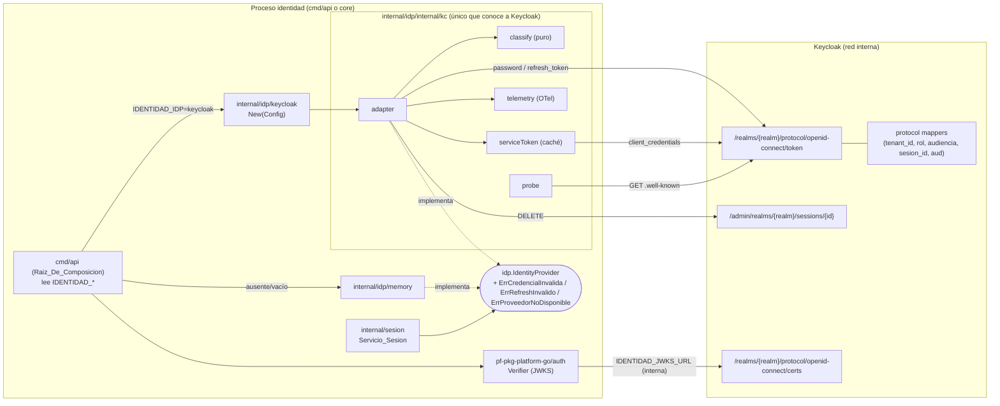
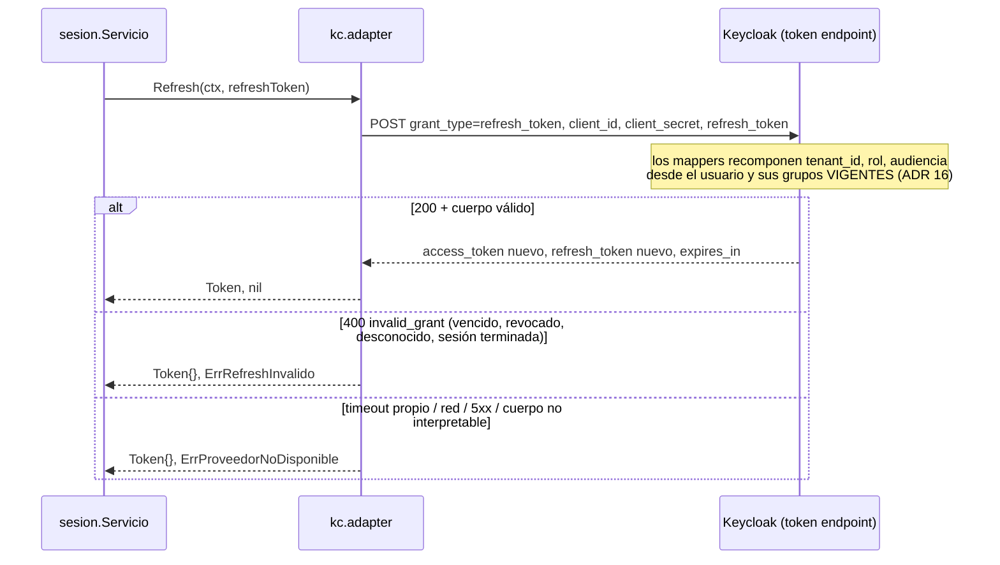

# Design Document

**E4-T1 — Adaptador del IdP (Keycloak)** · Documento de diseño

| | |
| --- | --- |
| **Estado** | En desarrollo — A-3, A-4, A-15 confirmadas; quedan A-1, A-2, A-7, A-13, A-16 |
| **Requisitos** | `requirements.md` de este spec (R1–R11, pendientes A-1, A-2, A-7, A-8…A-16) |
| **Repositorio** | `repos/pf-svc-identidad` |
| **Fecha** | 2026-10-08 |

Convención del documento: **[Propuesta técnica]** marca una elección de Kiro que el equipo puede aceptar o cambiar sin pasar por Product Management. **[Decisión pendiente]** marca algo que el diseño no decide porque depende de una regla de producto o de una ADR/DEC abierta; el diseño queda preparado para cualquiera de las opciones listadas. Ningún nombre propuesto (variables de entorno, claims nuevos, nombres de métricas) existe hoy en el código ni en las fuentes.

## Overview

El adaptador implementa `idp.IdentityProvider` contra Keycloak con tres llamadas HTTP: grant de contraseña (o el flujo que fije A-3) y grant de refresco contra el endpoint de token del realm, y borrado de sesión contra la API de administración. Todo lo que sabe de Keycloak vive en un único árbol de paquetes; el resto de `identidad` sólo ve el puerto, tres errores centinela nuevos en `internal/idp` y un constructor.

La composición de claims **no** corre en el adaptador: corre dentro de Keycloak (ADR 32 §4). La propuesta para V1 usa sólo *protocol mappers* nativos, con Keycloak como réplica de `rol`, `tenant` y `Audiencia` (atributos de grupo y de usuario). La coherencia con `claims.Componer` se verifica de dos formas: una prueba pura sobre el artefacto del realm y una prueba de integración que emite, refresca y verifica tokens reales con `pf-pkg-platform-go/auth`.

### Hallazgos de la lectura del código que condicionan el diseño

| # | Hallazgo (verificado) | Consecuencia |
| --- | --- | --- |
| H1 | `cmd/api` no puede importar `internal/idp/internal/...` (regla `internal` de Go: sólo lo importa el árbol `internal/idp/...`) | Hace falta una fachada en `internal/idp/keycloak` (§Arquitectura) |
| H2 | `memory.ErrCredencialInvalida` y `memory.ErrRefreshInvalido` no tienen llamadores fuera de `memory` (grep 2026-10-08) | La migración a centinelas del puerto es local al doble y su test |
| H3 | `pf-pkg-platform-go/auth` lee `sub`, `rol`, `tenant_id`, `sesion_id` y `audiencia`; sólo acepta claves `RSA`/`RS256` con `kid`; exige `aud` = audiencia esperada (`ai27-internal` por defecto en `cmd/api`); no valida `iss` | El realm debe firmar en RS256 y agregar `ai27-internal` a `aud` con un *audience mapper*. La falta de validación de `iss` se reporta como observación (fuera de alcance) |
| H4 | `autorizacion.Sujeto` separa `ID` (UUID de AI27) de `IdpSubject` (el `sub` del IdP); `claims.Componer` usa `SujetoID` | El `sub` de Keycloak **no** es `SujetoID` salvo que se alineen. Afecta R6.6 y A-13 |
| H5 | `health.ReadinessHandler` responde 503 si falla cualquier check y escribe `err.Error()` en el cuerpo | Un check de Keycloak no puede ir al `Registry` de `/ready` (A-12); su error debe ir saneado |
| H6 | `observability` declara que "los componentes usan la API de OTel directamente"; el proveedor global lo fija `observability.Init` en la raíz; `cmd/api` hoy no lo llama | El adaptador usa `otel.Meter`; sin `Init` las señales son no-op y el comportamiento no cambia (R10.6) |
| H7 | `migrations/identidad/0001_init.sql` crea `sesion.sesion_id UUID` con índice `una_sesion_viva` (a lo sumo una sesión viva por sujeto) | Relevante para A-4 y R7.5 (§Decisiones abiertas) |
| H8 | `internal/autorizacion` y `internal/claims` ya usan `testing/quick` para PBT | Se mantiene `testing/quick`; no se agrega biblioteca de PBT |
| H9 | `go.mod` ya trae `testcontainers-go v0.44.0` y `go.opentelemetry.io/otel{,/metric,/trace} v1.46.0` como indirectas | No se agregan dependencias de producción nuevas (§Elección de biblioteca) |

## Architecture

### Paquetes

```
internal/idp/
├── port.go                 # puerto (sin cambios de firma) + errores centinela NUEVOS
├── memory/                 # doble: migra a los centinelas del puerto
├── idptest/                # suite de contrato: 4 casos intactos + casos nuevos
├── keycloak/               # FACHADA: Config (alias) + New; sin tipos de terceros
│   └── keycloak.go
└── internal/
    ├── doc.go              # se actualiza: deja de decir "EN ESPERA"
    └── kc/                 # ADAPTADOR: único lugar que conoce rutas y formatos de Keycloak
        ├── adapter.go      # Issue / Refresh / Revoke
        ├── config.go       # Config + validación
        ├── classify.go     # respuesta HTTP/OAuth → categoría (función pura)
        ├── servicetoken.go # token de la cuenta de servicio (client_credentials) con caché
        ├── telemetry.go    # histograma OTel
        ├── probe.go        # verificación de alcanzabilidad (R9.5)
        ├── *_test.go       # unitarias con httptest.Server
        └── integration_test.go  # //go:build integration (testcontainers)
deploy/keycloak/
└── realm-ai27.json         # artefacto versionado del realm (R5.7), sin usuarios ni secretos
internal/idp/internal/kc/testdata/
└── realm-ai27-users-0.json # usuarios de prueba (sólo Keycloak_De_Prueba)
internal/archtest/
└── isolation_test.go       # verificación local de aislamiento (R2.2, R2.3)
```

**[Propuesta técnica] Fachada `internal/idp/keycloak` + implementación en `internal/idp/internal/kc`.** Alternativa considerada: mover el adaptador a `internal/idp/keycloak` y borrar `internal/idp/internal`. Se descarta porque:

- Conserva la intención escrita en `internal/idp/internal/doc.go` y en `identidad.md` (d): el código que conoce al proveedor queda inalcanzable incluso para `internal/sesion` o `internal/http`.
- La fachada es una función de una línea y un alias de tipo; R2.4 se verifica con facilidad porque su superficie exportada es mínima y no contiene tipos de terceros.
- La regla de aislamiento (R2.2) se expresa como "nada fuera de `internal/idp/internal` importa la Lista_De_Bibliotecas_IdP ni contiene rutas de Keycloak", y la fachada también queda sujeta a ella.

El paquete se llama `kc` (no `keycloak`) para no tener dos paquetes `keycloak` en el mismo árbol.

### Diagrama de componentes



### Secuencia: `Issue`

```mermaid
sequenceDiagram
  participant S as sesion.Servicio
  participant A as kc.adapter
  participant K as Keycloak (token endpoint)
  S->>A: Issue(ctx, Credentials)
  A->>A: callCtx = WithTimeout(ctx, cfg.Timeout); t0 = now
  A->>K: POST grant_type=password, client_id, client_secret, username, password [+ factor según A-3]
  alt 200 + cuerpo válido
    K-->>A: access_token, refresh_token?, expires_in
    A->>A: ExpiraEn = recibidoEn.UTC() + expires_in
    A-->>S: Token, nil
  else 400 invalid_grant
    A-->>S: Token{}, ErrCredencialInvalida (o categoría de factor, A-3)
  else ctx del llamador cancelado/vencido
    A-->>S: Token{}, error que envuelve ctx.Err()
  else timeout propio / red / 5xx / cuerpo no interpretable
    A-->>S: Token{}, ErrProveedorNoDisponible
  end
  A->>A: telemetry.record(issue, categoría, now - t0)
```

### Secuencia: `Refresh`



### Secuencia: `Revoke`

```mermaid
sequenceDiagram
  participant S as sesion.Servicio
  participant A as kc.adapter
  participant T as serviceToken
  participant K as Keycloak
  S->>A: Revoke(ctx, sesionID)
  A->>A: kcSessionID = cfg.SessionResolver(ctx, sesionID) (A-4)
  A->>T: token(ctx)
  alt caché vigente
    T-->>A: bearer
  else
    T->>K: POST grant_type=client_credentials (cliente de servicio)
    K-->>T: access_token (expires_in)
    T-->>A: bearer
  end
  A->>K: DELETE /admin/realms/{realm}/sessions/{kcSessionID}
  alt 204 / 200 / 404
    A-->>S: nil  (404 = ya terminada o inexistente: idempotente, R7.2)
  else 401 una vez
    A->>T: invalidar caché; reintentar UNA vez con token nuevo
  else 401 tras reintento / 403
    A-->>S: ErrProveedorNoDisponible (nunca éxito, R7.6)
  else timeout / red / 5xx
    A-->>S: ErrProveedorNoDisponible (R7.3)
  end
```

## Components and Interfaces

### Elección de biblioteca (R2, Lista_De_Bibliotecas_IdP)

| Opción | Versión vigente (proxy.golang.org, 2026-10-08) | A favor | En contra |
| --- | --- | --- | --- |
| **`net/http` de la biblioteca estándar** | — (Go 1.27) | Cero dependencias nuevas. Control total del formulario (A-3 puede exigir un parámetro de factor, p. ej. `totp`, que `x/oauth2` no deja agregar al grant de contraseña). Control total del texto de error (R3.2, R3.7). La superficie es pequeña: dos `POST` de formulario, un `DELETE` y un `GET` | Hay que escribir el decodificado de la respuesta de token y del error OAuth (≈100 líneas, cubiertas con `httptest`) |
| `golang.org/x/oauth2` (+ `clientcredentials`) | `v0.37.0` (2026-08-25) | Mantenida por el equipo de Go; `RetrieveError.ErrorCode` da el código OAuth | `PasswordCredentialsToken` no acepta parámetros extra; `RetrieveError.Error()` incluye el cuerpo crudo de la respuesta, lo que obliga a envolverlo de todas formas; no cubre la API de administración |
| `github.com/coreos/go-oidc/v3` | `v3.21.0` (2026-09-01) | Descubrimiento OIDC y verificación de ID token | Resuelve un problema que aquí no existe: la verificación de access token ya la hace `pf-pkg-platform-go/auth`. No cubre grants ni administración |
| `github.com/Nerzal/gocloak/v13` | `v13.9.0` (2024-02-01, sin release en ~2.7 años) | Cubre token y administración | Superficie enorme (cientos de métodos), arrastra `go-resty` y otras dependencias, tipos propios en las firmas, mantenimiento estancado |

**[Propuesta técnica] `net/http` estándar.** Es la superficie mínima, no agrega dependencias y es la única opción que deja abierta la forma del grant mientras A-3 no se decida.

**Lista_De_Bibliotecas_IdP resultante** (rutas prohibidas fuera de `internal/idp/internal`, y en todo el módulo las de AWS). Como el adaptador no usa ninguna, la lista es preventiva: impide que alguien las agregue fuera del árbol.

| Prefijo de ruta de import | Regla |
| --- | --- |
| `golang.org/x/oauth2` | Sólo dentro de `internal/idp/internal` |
| `github.com/coreos/go-oidc` | Sólo dentro de `internal/idp/internal` |
| `github.com/Nerzal/gocloak` | Sólo dentro de `internal/idp/internal` |
| `github.com/zitadel/oidc` | Sólo dentro de `internal/idp/internal` |
| `github.com/go-jose/go-jose`, `gopkg.in/square/go-jose` | Sólo dentro de `internal/idp/internal` |
| `github.com/stillya/testcontainers-keycloak` | Sólo dentro de `internal/idp/internal` |
| `github.com/aws/aws-sdk-go`, `github.com/aws/aws-sdk-go-v2` | **Prohibidas en todo el módulo** (R2.3, DEC-062) |

Además de imports, la verificación busca **literales de cadena** con `/protocol/openid-connect/` o `/admin/realms/` fuera de `internal/idp/internal` (R2.1: "todo código que construya peticiones hacia endpoints de Keycloak"). La lista se agrega al Glossary de `requirements.md` cuando se apruebe este diseño; este documento no modifica `requirements.md`.

### Puerto: `internal/idp/port.go` (cambios)

Las firmas de `IdentityProvider`, `Credentials` y `Token` no cambian (R1.1). Se agregan los errores centinela:

```go
// Errores centinela del puerto. Cada implementación devuelve un error que
// cumple errors.Is con EXACTAMENTE uno de ellos (R3.6), salvo cancelación o
// vencimiento del contexto del llamador, que se devuelve envolviendo ctx.Err()
// (R3.5). No son la taxonomía de la plataforma: la traducción a
// pf-pkg-platform-go/errors la hace el llamador (E4-T3).
var (
	// ErrCredencialInvalida: el IdP rechazó usuario o contraseña. El texto no
	// distingue usuario inexistente de contraseña incorrecta (R3.1, R3.2).
	ErrCredencialInvalida = errors.New("idp: credencial inválida")
	// ErrRefreshInvalido: el IdP rechazó el refresh token (vencido, revocado o
	// desconocido) (R3.4).
	ErrRefreshInvalido = errors.New("idp: refresh token inválido")
	// ErrProveedorNoDisponible: el IdP no respondió a tiempo, no es alcanzable,
	// respondió 5xx o una respuesta no interpretable (R3.3, R7.3).
	ErrProveedorNoDisponible = errors.New("idp: proveedor no disponible")
)
```

**[Decisión pendiente] Categoría de segundo factor (R4.2, A-3) y de modelo incompleto (R6.9, A-14).** El diseño reserva dos puntos de extensión sin crearlos todavía:

- Si A-3 decide que la falla de segundo factor debe distinguirse de la credencial inválida, se agrega `ErrSegundoFactorInvalido` al puerto y una fila en la tabla de clasificación. Si no, se mapea a `ErrCredencialInvalida`. En ambos casos queda fuera de `ErrProveedorNoDisponible` (R4.2).
- R6.9 sólo se activa con un mapper que pueda abortar la emisión (opción SPI de §Mapper de claims). Con mappers nativos, Keycloak no rechaza; la garantía se mueve a la sincronización de `identidad` y a la prueba del artefacto (ver Propiedad 7).

Ningún llamador de producción depende hoy de los centinelas (H2). E4-T3 los traducirá en `internal/sesion`/`internal/http`. Sugerencia para E4-T3, no parte de este spec: `ErrCredencialInvalida`/`ErrRefreshInvalido` → `CategoryNoAutorizado` (401); `ErrProveedorNoDisponible` → `CategoryDegradado` (503).

### Doble en memoria: migración (R1.3)

- `memory.Issue` devuelve `idp.ErrCredencialInvalida`; `memory.Refresh` devuelve `idp.ErrRefreshInvalido`.
- Se **borran** `memory.ErrCredencialInvalida` y `memory.ErrRefreshInvalido`, sin alias ni reexportación. No hay llamadores que migrar fuera del paquete (H2).
- El doble no produce `ErrProveedorNoDisponible`. Para que la suite pueda ejercitar esa categoría contra el doble, se agrega una ayuda de prueba `(*Provider).SimularCaida(bool)`, de modo que, mientras esté activa, `Issue`, `Refresh` y `Revoke` devuelvan `idp.ErrProveedorNoDisponible`.

### Suite de contrato: `internal/idp/idptest` (R1.2, R1.3, R3)

Los cuatro casos existentes, su nombre, cuerpo, aserciones y la firma de `Factory` **no cambian**. Se agrega una función nueva, opcional para cada implementación:

```go
// Categorias corre los casos de clasificación de errores. Es aditiva:
// Ejecutar sigue siendo la suite de contrato original sin cambios.
func Categorias(t *testing.T, nueva Factory)
```

Casos de `Categorias`:

1. "credencial inválida se clasifica como ErrCredencialInvalida": `errors.Is(err, idp.ErrCredencialInvalida)` y ninguno de los otros dos centinelas; `Token` vacío por completo (`AccessToken`, `RefreshToken`, `ExpiraEn.IsZero()`).
2. "usuario inexistente y contraseña incorrecta producen el mismo texto": `err1.Error() == err2.Error()` y el texto no contiene el usuario.
3. "refresh desconocido se clasifica como ErrRefreshInvalido".
4. "refresh ya usado o de sesión revocada se clasifica como ErrRefreshInvalido": emite, revoca (o rota) y vuelve a refrescar. Para Keycloak depende de la correlación de A-4. Mientras A-4 no se decida, el caso usa la rotación del refresh token si el realm la activa (`revokeRefreshToken=true`); si no aplica, se omite con mensaje explícito.
5. "contexto cancelado no se clasifica como credencial ni refresh": `errors.Is(err, context.Canceled)`.

La caída del proveedor no se prueba en la suite genérica (la Factory no sabe tumbar Keycloak); se prueba en las unitarias del adaptador con `httptest.Server` y en el doble con `SimularCaida`.

### Fachada: `internal/idp/keycloak`

```go
// Package keycloak es el punto de paso que la raíz de composición puede
// importar para construir el adaptador de Keycloak. No contiene lógica ni
// tipos de terceros (R2.4).
package keycloak

// Config es la configuración ya resuelta del adaptador.
type Config = kc.Config

// New valida la configuración y construye el adaptador. No hace llamadas de
// red (R2.6).
func New(cfg Config) (idp.IdentityProvider, error) { return kc.New(cfg) }

// Probe devuelve la verificación de alcanzabilidad de Keycloak (R9.5).
func Probe(cfg Config) (func(ctx context.Context) error, error) { return kc.NewProbe(cfg) }
```

### Adaptador: `internal/idp/internal/kc`

```go
// adapter implementa idp.IdentityProvider contra Keycloak.
type adapter struct {
	cfg     Config
	http    *http.Client
	svc     *serviceToken
	tel     telemetry
	now     func() time.Time // inyectable en pruebas
}

func New(cfg Config) (idp.IdentityProvider, error)
func (a *adapter) Issue(ctx context.Context, cred idp.Credentials) (idp.Token, error)
func (a *adapter) Refresh(ctx context.Context, refreshToken string) (idp.Token, error)
func (a *adapter) Revoke(ctx context.Context, sesionID string) error
```

Comportamiento común de cada llamada:

1. `callCtx, cancel := context.WithTimeout(ctx, cfg.Timeout)`; `defer cancel()`. La petición se crea con `http.NewRequestWithContext(callCtx, …)`, de modo que la cancelación del llamador corta la llamada en curso (R3.5).
2. Al terminar, `classify` (función pura) recibe `(op, statusCode, oauthError, transportErr, ctx.Err(), callCtx.Err(), bodyOK)` y devuelve **una** `categoria`. `categoria` es un enum interno: `exito`, `credencialInvalida`, `refreshInvalido`, `proveedorNoDisponible`, `cancelado` y, si A-3 lo pide, `segundoFactor`.
3. `errorDe(categoria)` construye el error devuelto: `fmt.Errorf("idp/keycloak: %s: %w", op, centinela)`. Nunca envuelve el error del transporte ni el cuerpo de la respuesta. El único detalle que puede agregar es el código HTTP y el código OAuth tomado de una lista cerrada (`invalid_grant`, `invalid_client`, `unauthorized_client`, `invalid_request`, `unsupported_grant_type`, `invalid_scope`). Así, ni la contraseña, ni los tokens, ni el usuario, ni el `error_description` llegan al mensaje (R3.2, R3.7, R4.5). El error de transporte de `net/http` (`*url.Error`) incluye la URL, que no lleva secretos porque las credenciales van en el cuerpo del formulario, no en la URL. Aun así, no se envuelve: sólo se registra su tipo (`timeout`, `dns`, `conn_refused`) como atributo de telemetría.
4. `tel.record(ctx, op, categoria, duracion)` se llama exactamente una vez, con `defer`, en todas las salidas (R10.1, R10.2).

`ExpiraEn` (R1.4, R1.5): `recibidoEn.UTC().Add(time.Duration(expires_in) * time.Second)`, donde `recibidoEn` se toma al recibir los encabezados de la respuesta. Keycloak calcula `exp = iat + expires_in` en segundos enteros, así que la diferencia con `exp` está acotada por la latencia de red más el redondeo a segundos. Si `expires_in <= 0` o falta `access_token`, la respuesta se clasifica como no interpretable (`proveedorNoDisponible`).

`serviceToken`: obtiene el token de la cuenta de servicio con `client_credentials` y lo guarda en caché hasta `expires_in − 10 s`, protegido con `sync.Mutex`. No arranca goroutines (se obtiene bajo demanda). Ante un 401 del `DELETE` invalida la caché y reintenta una sola vez.

### Configuración (R2.5, R2.6, R3.8, R3.9, R8.4)

```go
// Config es la configuración ya resuelta del adaptador. El adaptador no lee
// entorno ni archivos (R2.5).
type Config struct {
	// TokenURL y RefreshURL: endpoint de token del realm en la red interna.
	// En Keycloak son la misma URL; se reciben por separado (R8.4).
	TokenURL   string
	RefreshURL string
	// AdminSessionsURL: base interna "…/admin/realms/{realm}/sessions" (R8.4).
	AdminSessionsURL string
	// ClientID/ClientSecret: cliente OIDC de login (confidencial).
	ClientID     string
	ClientSecret string
	// ServiceClientID/ServiceClientSecret: cliente de servicio para Revoke,
	// distinto del de login (R7.4).
	ServiceClientID     string
	ServiceClientSecret string
	// Timeout: tiempo límite por llamada; obligatorio, > 0, sin valor por
	// omisión (R3.8, R3.9; valor pendiente, R3 nota (a)).
	Timeout time.Duration
	// HTTPClient opcional; si es nil se usa uno propio sin Timeout global (el
	// límite lo pone el contexto por llamada).
	HTTPClient *http.Client
	// MeterProvider opcional; si es nil se usa otel.GetMeterProvider() (H6).
	MeterProvider metric.MeterProvider
	// SessionResolver traduce el sesion_id de AI27 al id de sesión de Keycloak
	// (costura de A-4). Si es nil se usa la identidad (opción A-4 (i)). Un
	// error del resolvedor se devuelve envuelto y nunca como éxito.
	SessionResolver func(ctx context.Context, sesionID string) (string, error)
}

// Validate devuelve un error que nombra TODOS los campos faltantes o inválidos,
// sin incluir ningún valor (R2.6, R3.9, R9.3).
func (c Config) Validate() error
```

`Validate` devuelve un error que lista **todos** los campos faltantes o inválidos en un solo mensaje, por ejemplo `kc: configuración inválida: faltan ClientSecret, ServiceClientID; Timeout debe ser > 0`. También rechaza URLs que no parseen o que no tengan esquema `http`/`https`. `New` llama a `Validate` antes de crear cualquier recurso y no hace llamadas de red (R2.6).

`MeterProvider` usa el tipo de la API de OTel (`go.opentelemetry.io/otel/metric`), no de una biblioteca de IdP, así que no entra en conflicto con R2.4.

### Raíz de composición: `cmd/api/main.go` (R9)

**[Propuesta técnica, pendiente de validación] Nombres de variables** (A-15):

| Variable | Campo | Notas |
| --- | --- | --- |
| `IDENTIDAD_IDP` | selección | `memory` \| `keycloak`; ausente o vacío = `memory` (R9.2); otro valor = falla (R9.6) |
| `IDENTIDAD_KEYCLOAK_TOKEN_URL` | `TokenURL` | URL interna |
| `IDENTIDAD_KEYCLOAK_REFRESH_URL` | `RefreshURL` | Por omisión igual a `TOKEN_URL` si está vacía. **[Propuesta]**; si se rechaza, pasa a ser obligatoria |
| `IDENTIDAD_KEYCLOAK_ADMIN_SESSIONS_URL` | `AdminSessionsURL` | URL interna |
| `IDENTIDAD_KEYCLOAK_CLIENT_ID` | `ClientID` | |
| `IDENTIDAD_KEYCLOAK_CLIENT_SECRET` / `…_FILE` | `ClientSecret` | Secreto (R9.4) |
| `IDENTIDAD_KEYCLOAK_SERVICE_CLIENT_ID` | `ServiceClientID` | |
| `IDENTIDAD_KEYCLOAK_SERVICE_CLIENT_SECRET` / `…_FILE` | `ServiceClientSecret` | Secreto (R9.4) |
| `IDENTIDAD_KEYCLOAK_TIMEOUT` | `Timeout` | `time.ParseDuration`; obligatoria, sin valor por omisión |

Secretos (R9.4): para cada secreto, si existe `X_FILE`, se lee el archivo montado (p. ej. un Secret de k3s) y se recortan los espacios finales. Si no, se lee `X`. Si existen ambas, es error de configuración, porque la ambigüedad oculta errores de despliegue. Nada se fija en código.

Flujo en `run()`:

1. `sel := os.Getenv("IDENTIDAD_IDP")`.
2. `switch sel`: `""`, `"memory"` → `memory.New()`, sin tocar Keycloak (R9.2). `"keycloak"` → `cargarConfigKeycloak()` junta **todos** los faltantes y devuelve un solo error (R9.3); después `keycloak.New(cfg)`. `default` → error `IDENTIDAD_IDP: valor no aceptado; valores aceptados: memory, keycloak`, sin repetir el valor recibido (R9.6).
3. Cualquier error en el paso 2 se devuelve **antes** de `pgxpool.New` y de `ListenAndServe`; `main` termina con `log.Fatalf` (código distinto de cero).
4. `log.Printf("identidad/cmd/api: proveedor de identidad: %s", "keycloak"|"memory")` (R9.7).
5. Si es Keycloak, se monta la verificación de alcanzabilidad (§Health).

**Decisión de orden:** hoy `cmd/api` abre el pool de Postgres antes que nada. La configuración del IdP se resuelve **antes** del pool para fallar rápido sin efectos. Es un cambio de orden menor y no altera el comportamiento standalone (R9.2).

### Health: alcanzabilidad de Keycloak (R9.5, A-12)

**[Propuesta técnica] Registro aparte, sin cambios en `pf-pkg-platform-go`.** Las opciones:

| Opción | Cambio en platform-go | Efecto en `/ready` | Observación |
| --- | --- | --- | --- |
| **(1) Segundo `health.Registry` montado en `/ready/idp`** | No | Ninguno | Reutiliza `ReadinessHandler` (timeout de 5 s ya incluido, check con nombre `idp:keycloak`). `/ready/idp` responde 503 si Keycloak cae; `/ready` sigue en 200 |
| (2) Checks informativos en `health.Registry` | Sí: API nueva + release + subir pin | Ninguno | Más limpio a largo plazo; mayor costo |
| (3) Sólo telemetría | No | Ninguno | No hay un "resultado con nombre propio" consultable; cumple R9.5 sólo a medias |
| (4) `RegisterCheck` en el registro principal | No | 503 si Keycloak cae | Contradice R9.5 |

Se propone (1), más la métrica de R10 como señal complementaria. La función de check (`kc.NewProbe`) hace `GET` al documento `.well-known/openid-configuration` del realm, derivado de `TokenURL`, con su propio `context.WithTimeout(ctx, 5*time.Second)`. Devuelve sólo errores saneados (`idp:keycloak no alcanzable` o `idp:keycloak respondió <código>`), porque `ReadinessHandler` escribe `err.Error()` en el cuerpo (H5). El arranque **no** espera a Keycloak: si Keycloak no es alcanzable, el proceso arranca igual. Esto es coherente con la propuesta de R9.5, pero queda **[Decisión pendiente]** junto con R9.5 (nota de requisitos).

### Observabilidad (R10)

**[Propuesta técnica]** Un solo instrumento cubre R10.1 y R10.2: el conteo del histograma por `resultado` da "exactamente un resultado por llamada", y su valor da la latencia.

| Instrumento | Tipo | Unidad | Atributos |
| --- | --- | --- | --- |
| `ai27_idp_duracion_segundos` | `Float64Histogram` | `s` | `dependencia=keycloak` (R10.4), `operacion` ∈ {`issue`,`refresh`,`revoke`}, `resultado` ∈ {`exito`,`credencial_invalida`,`refresh_invalido`,`proveedor_no_disponible`,`otro`} |

- El nombre sigue el patrón `ai27_*` de `observability.NewWorkerMetrics`. Los nombres de instrumento son propuesta, no contrato (comentario de `metrics.go`).
- `resultado=otro` es el nombre provisional de la categoría de R10.5: cancelación del contexto del llamador y, si A-3 la distingue, falla de segundo factor. Su nombre y si se divide son **[Decisión pendiente]** (A-14).
- Sin atributos con usuario, `sesion_id`, tokens ni contraseña (R10.3). El atributo `causa` (`timeout`, `dns`, `conn_refused`, `http_5xx`, `cuerpo_invalido`) se agrega sólo con `resultado=proveedor_no_disponible`, de una lista cerrada.
- Trazas: un span `idp.keycloak.<operacion>` (cliente), con los mismos atributos y sin otros.
- R10.6: la API de OTel no devuelve errores al registrar y la exportación es asíncrona, en el `PeriodicReader` de `observability`. La falla de exportación no puede alterar el resultado. Una prueba unitaria usa un `MeterProvider` cuyo exportador siempre falla y verifica que el resultado sea idéntico.
- La raíz no inicializa OTel hoy (H6). **[Propuesta]** Llamar `observability.Init` en `cmd/api` sólo si se configura un endpoint OTLP. Si no, la instrumentación es no-op. No es requisito de E4-T1; se deja anotado para la tarea de raíz de composición.

### Verificación de aislamiento (R2.1–R2.3, R2.7, A-11)

**[Propuesta técnica] Prueba Go local en `internal/archtest/isolation_test.go`**, que corre con `go test ./...` (ya está en CI). No cambia `arch-test`, que se sigue ejecutando igual (R2.7).

- Usa `go list -deps=false -test -json ./...` vía `os/exec` para obtener, por paquete, `ImportPath`, `Imports`, `TestImports` y `XTestImports`. Lo hace dos veces: sin tags y con `-tags integration`, para cubrir los `_test.go` y los archivos con `integration` (R2.1). Se prefiere a `golang.org/x/tools/go/packages` porque no agrega dependencias.
- Regla A (R2.2): para todo paquete cuyo `ImportPath` no tenga el prefijo `…/internal/idp/internal`, ningún import tiene un prefijo de la Lista_De_Bibliotecas_IdP.
- Regla B (R2.3): ningún paquete importa `github.com/aws/aws-sdk-go` ni `github.com/aws/aws-sdk-go-v2`.
- Regla C (R2.1): recorre con `go/parser` los `.go` fuera de `internal/idp/internal` y falla si un `*ast.BasicLit` de cadena contiene `/protocol/openid-connect/` o `/admin/realms/`. Excluye el propio archivo de la prueba, que declara esos patrones.
- Salida: `t.Errorf("%s importa %s (prohibido fuera de internal/idp/internal)", pkg, imp)`, que nombra el paquete y la ruta (R2.2, R2.3).
- La prueba es directa sobre `go list` y no tiene costo de red: la caché de módulos ya está resuelta por `go build`.

Alternativa (a) de A-11: extender `arch-test` en `pf-pkg-platform-go` con reglas de imports de terceros por servicio. Sigue disponible. Si se hace después, la prueba local se borra cuando `arch-test` la cubra.

## Data Models

### Respuestas de Keycloak que el adaptador decodifica

```go
// tokenResponse: cuerpo 200 del endpoint de token (RFC 6749 §5.1).
type tokenResponse struct {
	AccessToken  string `json:"access_token"`
	RefreshToken string `json:"refresh_token"`
	ExpiresIn    int64  `json:"expires_in"`
	TokenType    string `json:"token_type"`
	SessionState string `json:"session_state"` // id de la sesión de Keycloak; candidato para A-4
}

// oauthError: cuerpo de error (RFC 6749 §5.2). ErrorDescription NUNCA se
// propaga a errores ni a telemetría.
type oauthError struct {
	Error            string `json:"error"`
	ErrorDescription string `json:"error_description"`
}
```

`tokenResponse` y `oauthError` no se exportan. El `json.Decoder` se limita con `io.LimitReader` (64 KiB) para que un cuerpo anómalo se clasifique como no interpretable y no agote memoria.

### Tabla de clasificación (`classify`, función pura)

Precedencia de arriba abajo; la primera fila que aplique decide. Así cada entrada cae en exactamente una categoría (Propiedad 1).

| # | Condición | `Issue` | `Refresh` | `Revoke` |
| --- | --- | --- | --- | --- |
| 1 | `ctx` del llamador con `Err() != nil` (cancelado o vencido) | `cancelado` (envuelve `ctx.Err()`) | `cancelado` | `cancelado` |
| 2 | `callCtx` vencido por `cfg.Timeout` | `proveedorNoDisponible` | `proveedorNoDisponible` | `proveedorNoDisponible` |
| 3 | Error de transporte (DNS, conexión rechazada, TLS, EOF) | `proveedorNoDisponible` | `proveedorNoDisponible` | `proveedorNoDisponible` |
| 4 | HTTP 5xx | `proveedorNoDisponible` | `proveedorNoDisponible` | `proveedorNoDisponible` |
| 5 | HTTP 200 con cuerpo no JSON, sin `access_token` o `expires_in <= 0` | `proveedorNoDisponible` | `proveedorNoDisponible` | n/a |
| 6 | HTTP 200 válido | `exito` | `exito` | n/a |
| 7 | `Revoke`: 204, 200 o 404 | n/a | n/a | `exito` (R7.1, R7.2) |
| 8 | `Revoke`: 401 tras el reintento, o 403 | n/a | n/a | `proveedorNoDisponible` **[Propuesta]** (R7.6 sólo exige "error, nunca éxito") |
| 9 | HTTP 400 `invalid_grant` | `credencialInvalida` **[A-3/A-14]** | `refreshInvalido` | n/a |
| 10 | HTTP 400/401 `invalid_client`, `unauthorized_client`, `unsupported_grant_type`, `invalid_request`, `invalid_scope` | `proveedorNoDisponible` **[Propuesta, A-14]** | `proveedorNoDisponible` **[Propuesta, A-14]** | n/a |
| 11 | Cualquier otro código (incluido 429 y 4xx sin cuerpo OAuth) | `proveedorNoDisponible` **[Propuesta]** | `proveedorNoDisponible` **[Propuesta]** | `proveedorNoDisponible` |

Notas sobre la fila 9 (verificar contra la versión fijada en A-7 en la prueba de integración):

- Keycloak responde `invalid_grant` con el mismo `error_description` (`Invalid user credentials`) para usuario inexistente y contraseña incorrecta. Aun así, el adaptador no lo usa: el texto devuelto es una constante (R3.2).
- Keycloak también usa `invalid_grant` para "cuenta deshabilitada" y "cuenta no configurada por completo" (acción requerida pendiente, p. ej. enrolar OTP). Hoy esas causas caen en `credencialInvalida`, y la categoría propia queda en A-14. Si A-14 pide distinguirlas, la única señal disponible es `error_description`, que varía entre versiones; por eso cualquier distinción por descripción va con pruebas fijadas a la versión de A-7.
- La falla de segundo factor en el grant directo también llega como `invalid_grant`. Ver A-3.

La fila 10 se propone como `proveedorNoDisponible` porque son fallas de configuración del despliegue, no del usuario: si se reportaran como credencial inválida, se investigarían como un problema del usuario. Confirmar en A-14.

### Artefacto del realm: `deploy/keycloak/realm-ai27.json` (R5, R4.1, R6)

**[Propuesta técnica] Ubicación:** `deploy/keycloak/`, fuera de `testdata`, para que pueda convertirse en la fuente del realm de producción si se aprueba esa propuesta (nota de R5). Los usuarios de prueba viven aparte, en `internal/idp/internal/kc/testdata/realm-ai27-users-0.json`. Keycloak importa juntos los archivos `<realm>-users-N.json` del directorio de import, así que el artefacto versionado nunca contiene usuarios de prueba.

Contenido (forma; se escribe para un solo realm mientras A-1 no se decida):

| Elemento | Configuración propuesta | Requisito |
| --- | --- | --- |
| Realm | `realm: "ai27"`, `defaultSignatureAlgorithm: "RS256"` (H3), `revokeRefreshToken: true` y `refreshTokenMaxReuse: 0` **[Propuesta]** (rotación del refresh token, como el doble) | R6.8 |
| User profile | Atributo `tenant_id`: `permissions.view: ["admin"]`, `permissions.edit: ["admin"]`, `required` sólo para `admin`. Atributo `sujeto_id`, igual, si A-13 elige la opción (b). `unmanagedAttributePolicy` ausente (los atributos no declarados no se pueden editar) | R5.1, R5.2 |
| Grupos | Exactamente ocho grupos de primer nivel con los nombres de DEC-053. Cada grupo lleva los atributos `rol: ["<id>"]` y `audiencia: ["Cliente"]` (sólo `cliente`) o `["Interno"]` (los otros siete). Sin `auditor` | R5.3, R5.4, R6.5 |
| Cliente `ai27-login` | Confidencial; `serviceAccountsEnabled: false`; `directAccessGrantsEnabled` y `standardFlowEnabled` según A-3; sin roles de `realm-management`; *client scope* dedicado `ai27-claims` con los mappers; secreto `${KC_AI27_LOGIN_SECRET}` | R5.2, R5.9, R7.7 |
| Cliente `ai27-identidad-svc` | Confidencial; sólo `serviceAccountsEnabled: true` (sin grant directo ni flujo estándar); permisos para terminar sesiones según A-16 (abajo); secreto `${KC_AI27_SVC_SECRET}` | R7.4 |
| Flujo de autenticación | Copia del flujo de grant directo (`ai27-direct-grant`): *Username Validation* REQUIRED, *Password* REQUIRED, *OTP* REQUIRED (no condicional), ligado a `ai27-login` por *authentication flow binding override*. Si A-3 elige navegador: copia del flujo de navegador con *OTP Form* (o WebAuthn, A-2) REQUIRED. En ningún caso hay subflujos condicionales por grupo, rol o atributo | R4.1 |
| Required actions | `CONFIGURE_TOTP` como acción por omisión para usuarios nuevos **[Propuesta]**; el canal depende de A-2 | R4.1 |
| Mappers (`ai27-claims`) | Ver §Mapper de claims | R6 |

**Secretos (R5.10):** el artefacto usa marcadores `${KC_AI27_LOGIN_SECRET}` y `${KC_AI27_SVC_SECRET}`, que Keycloak sustituye desde variables de entorno al importar. La prueba los inyecta con valores aleatorios generados en cada ejecución (`crypto/rand`) por el entorno del contenedor. La sustitución de marcadores en el import debe verificarse con la versión de A-7; si no aplica, la prueba omite el campo `secret`, deja que Keycloak lo genere y lo lee por la API de administración del realm `master`, dentro del árbol `internal/idp/internal`.

**Hallazgo A-16 (nuevo, no registrado en requisitos): permisos mínimos para `Revoke` (R7.4).** Con los roles nativos de `realm-management`, terminar una sesión ajena por la API de administración requiere `manage-users`, que **también** permite modificar usuarios, grupos y atributos. Por lo tanto R7.4 no se cumple con roles nativos gruesos. Esto debe confirmarse en la prueba de integración con la versión de A-7. Opciones, que el diseño no elige:

- (a) *Fine-grained admin permissions v2* (soportado desde Keycloak 26.2) para acotar la cuenta de servicio. Falta verificar que exista una granularidad que permita cerrar sesión sin permitir `manage` sobre el usuario.
- (b) Aceptar `manage-users` para la cuenta de servicio y documentar la desviación de R7.4.
- (c) Revocar con el endpoint OIDC de *logout* y el refresh token de la sesión. Esto exige que `identidad` conserve el refresh token, lo que contradice `identidad.md` (a) ("AI27 no los persiste").

La prueba de R7.4 se escribe de modo que falle si la cuenta de servicio puede modificar un usuario. Así la opción elegida queda verificada, no supuesta.

Sobre R7.7: con la credencial del cliente de login, la **API de administración** rechaza cerrar sesiones porque el cliente no tiene cuenta de servicio ni roles. Pero el endpoint OIDC de *logout* acepta, por diseño del estándar, que un cliente cierre la sesión de **su propio** refresh token. La prueba de R7.7 apunta a la API de administración. Si PM entiende R7.7 como "el cliente de login no puede cerrar ninguna sesión por ninguna vía", hay contradicción con OIDC y debe precisarse.

### Usuarios de prueba (`testdata/realm-ai27-users-0.json`)

| Conjunto | Cantidad | Uso |
| --- | --- | --- |
| `factory-<rol>` con contraseña y credencial OTP importada con semilla conocida | 8 (uno por rol) | R1.6, R6.6, R6.8; coherencia por rol |
| `sin-factor-<rol>` sin credencial OTP | 8 | R4.4 |
| `cambio-rol` | 1 | R6.7 (la prueba cambia su grupo con la credencial administrativa de `master`) |
| Atributos | `tenant_id` y, si aplica, `sujeto_id` con UUID fijos | R5.5, R6.6 |

Las contraseñas de prueba son constantes de prueba, válidas sólo en el Keycloak_De_Prueba. No se reutilizan en ningún otro entorno.

### Mapper de claims (R6, A-6, A-8, A-13)

**[Decisión pendiente] A-6 (¿de qué historia es?) y A-8 (¿de dónde lee el modelo vigente?).** Las dos opciones técnicas:

| | (a) Mappers nativos; Keycloak como réplica | (b) Extensión Java (SPI `ProtocolMapper`) que consulta a `identidad` |
| --- | --- | --- |
| `tenant_id` | *User Attribute* `tenant_id` → claim `tenant_id`, `multivalued=false` | Leído de `identidad` |
| `rol` | *User Attribute* `rol` → claim `rol`, `multivalued=false`; el usuario no tiene el atributo propio, así que Keycloak lo resuelve heredado de su grupo de rol (comportamiento a confirmar con la versión de A-7) | Leído de `identidad` (`CargadorModeloVigente`) |
| `audiencia` | *User Attribute* `audiencia` (atributo del grupo) → claim `audiencia` | `AudienciaDeRol` portada o consultada |
| `aud` | *Audience* mapper con `ai27-internal` (H3) | Igual (nativo) |
| `sesion_id` | Según A-4 | Según A-4 |
| R6.9 (rechazar modelo incompleto) | **No** aplicable dentro de Keycloak: un mapper nativo no aborta la emisión. Si un usuario tiene dos grupos de rol, el mapper emite uno sin avisar | Aplicable: el SPI lanza error y Keycloak no emite |
| Dependencia en emisión | Ninguna nueva | Keycloak → `identidad` en cada emisión y refresco (latencia y disponibilidad acopladas; medir contra E4-T4) |
| Fuente de verdad | `identidad` (Postgres) + **sincronización** hacia grupos y atributos de Keycloak (E4-T6) | `identidad` en línea |
| Empaquetado | JSON del realm | JAR Java versionado con el módulo (`identidad.md` (k)), nuevo lenguaje y pipeline |

**[Propuesta técnica] (a) para V1.** No agrega lenguaje, pipeline ni dependencia de emisión, y todo es configuración versionada y probada. El costo es que R6.9 pasa de "Keycloak rechaza" a dos garantías verificables:

1. La sincronización de `identidad` (E4-T6) nunca deja a un usuario con cero o con más de un grupo de rol, ni sin `tenant_id`. `autorizacion.ErrRolNoUnico` ya existe del lado de `identidad`.
2. La prueba de integración detecta la violación: un usuario con dos grupos de rol emite un token cuyo `rol` no se puede predecir, así que la prueba lo trata como un caso que **debe** hacer fallar la verificación de coherencia (Propiedad 7).

Si PM o arquitectura exigen R6.9 literal, el diseño pasa a (b) y la Propiedad 7 se convierte en "Keycloak rechaza".

**Coherencia con `claims.Componer`** (R6.2, R6.5, R6.6):

- Prueba pura sobre el artefacto: se parsea `deploy/keycloak/realm-ai27.json`. Para cada grupo, `audiencia == string(autorizacion.AudienciaDeRol(roles.Rol(rol)))` y `rol` está en el enum del contrato. Para cada mapper del scope `ai27-claims`, el claim de destino es uno de los nombres que lee `pf-pkg-platform-go/auth`. Esta prueba corre en `go test ./...`, sin Docker.
- Prueba de integración: por cada usuario `factory-<rol>` se construye el `ModeloVigente` esperado a partir del archivo de usuarios de prueba. Se emite y se refresca, cada token se verifica con `auth.NewVerifier` contra el JWKS del contenedor y se compara campo a campo con `claims.Componer(m)` (R6.6, R6.8).

**[Decisión pendiente] A-13 — `sujeto` en el token.** H4 muestra que `SujetoID` ≠ `sub` de Keycloak por construcción. Opciones:

- (a) Alinear: crear el usuario de Keycloak con `id = sujeto.id` (la API de administración y el import aceptan `id`), de modo que `sub == SujetoID == IdpSubject`. Afecta el alta en E4-T6.
- (b) Claim propio `sujeto_id` desde el atributo de usuario `sujeto_id` (sólo admin), con `sub` = id de Keycloak. Requiere que `pf-pkg-platform-go/auth` lea ese claim, lo que implica una versión nueva de platform-go.
- (c) Usar `sub` de Keycloak como identidad en los consumidores y resolver `SujetoID` por `IdpSubject` en servidor. R6.6 compararía `sub` con `IdpSubject`, no con `SujetoID`.

El diseño queda preparado para las tres opciones: la prueba de coherencia toma de un solo lugar (`esperadoSujeto(m)`) el valor esperado para `sub`.

**[Decisión pendiente] A-13 — nombres de claims.** El diseño usa los que hoy lee `pf-pkg-platform-go/auth` (`sub`, `rol`, `tenant_id`, `sesion_id`, `audiencia`), sin `ConAudienciaClaim`. Ratificarlos como contrato es tarea de ADR/DEC. Si cambian, sólo cambian los `claim.name` del artefacto y la prueba pura los detecta.

## Correctness Properties

_Una propiedad es una característica o comportamiento que debe cumplirse en todas las ejecuciones válidas del sistema: un enunciado formal de lo que el sistema debe hacer. Las propiedades son el puente entre la especificación legible por humanos y las garantías de correctitud verificables por máquina._

El prework clasificó cada criterio de aceptación. La reflexión consolidó los criterios de clasificación de errores (R3.1, R3.3, R3.4, R3.6, R7.3, R7.6, R10.5) en una sola propiedad. También juntó los de ausencia de secretos (R3.7, R4.5, R10.3) y los de telemetría (R10.1, R10.2, R10.4). Las propiedades 1–12 son **PBT unitarias**: `testing/quick`, mínimo 100 iteraciones, sin red real (con `httptest.Server`, `RoundTripper` grabador o funciones puras). La propiedad 13 es **de integración**: se cuantifica sobre el conjunto finito de usuarios de prueba contra el Keycloak_De_Prueba y no corre 100 iteraciones.

### Property 1: Clasificación total, exclusiva y conforme a la tabla

*For any* operación (`issue`, `refresh`, `revoke`) y cualquier combinación de código HTTP, código OAuth (de la lista cerrada o arbitrario), cuerpo (válido, inválido, vacío), error de transporte (ninguno, DNS, conexión rechazada, EOF) y estado de los contextos (llamador cancelado o vencido, tiempo límite propio vencido, vigente), el error devuelto por el adaptador cumple exactamente una de estas condiciones: `errors.Is` con exactamente uno de `ErrCredencialInvalida`, `ErrRefreshInvalido` y `ErrProveedorNoDisponible`; `errors.Is(err, context.Canceled|DeadlineExceeded)` sin ningún centinela; o `nil`. La categoría es la que fija la primera fila aplicable de la tabla de clasificación. En particular, la cancelación del llamador nunca es credencial ni refresh inválido, y un 401/403 de `Revoke` nunca es `nil`. Cuando hay error, el `Token` es el valor cero.

**Validates: Requirements 3.1, 3.3, 3.4, 3.5, 3.6, 7.3, 7.6, 10.5**

### Property 2: Credencial rechazada no revela causa ni usuario

*For any* par de usuarios (cadenas arbitrarias, incluidas vacías y Unicode) y cualquier `error_description` devuelto por el servidor, los errores de `Issue` ante `invalid_grant` tienen textos idénticos entre sí, y ningún texto contiene el usuario enviado.

**Validates: Requirements 3.1, 3.2**

### Property 3: Ningún secreto llega a errores ni a telemetría

*For any* contraseña, valor de segundo factor, access token y refresh token generados aleatoriamente, y cualquier respuesta del servidor (incluidas las que repiten esos valores en `error_description` o en el cuerpo), ni el texto del error devuelto, ni los atributos registrados en el `MeterProvider`, ni los atributos de los spans contienen ninguno de esos valores como subcadena.

**Validates: Requirements 3.7, 4.5, 10.3**

### Property 4: Mapeo de la respuesta de token

*For any* respuesta 200 válida con `access_token` y `refresh_token` arbitrarios no vacíos y `expires_in` en `[1, 10^7]`, y cualquier instante de recepción `t`, `Issue` y `Refresh` devuelven `Token{AccessToken, RefreshToken}` iguales a los de la respuesta y `ExpiraEn == t.UTC().Add(expires_in·s)`, con `ExpiraEn.Location() == time.UTC`. Si `refresh_token` falta, `RefreshToken == ""` sin error.

**Validates: Requirements 1.4, 1.5**

### Property 5: Validación de configuración

*For any* `Config` construida a partir de una válida, vaciando un subconjunto arbitrario de campos obligatorios y dando a `Timeout` un valor arbitrario (incluidos `0` y negativos), `New` devuelve error si y sólo si el subconjunto no está vacío o `Timeout <= 0`. El texto nombra exactamente esos campos, no contiene el valor de ningún campo de la `Config` y el servidor de prueba recibe cero peticiones.

**Validates: Requirements 2.6, 3.9**

### Property 6: `Revoke` idempotente y acotado

*For any* conjunto de sesiones activas en un servidor de administración falso, cualquier `sesionID` (activo o inexistente) y cualquier número `n ≥ 1` de llamadas repetidas a `Revoke` con ese id, todas las llamadas devuelven `nil` y, al terminar, el conjunto de sesiones activas es el inicial menos, a lo sumo, la sesión correspondiente a ese id. Las únicas peticiones mutantes enviadas son `DELETE` a la ruta de esa sesión.

**Validates: Requirements 7.1, 7.2, 7.5**

### Property 7: Coherencia del artefacto del realm con el modelo

*For all* grupos de `deploy/keycloak/realm-ai27.json`, el conjunto de nombres de grupo es igual al conjunto de los ocho `Rol` del contrato, sin `auditor`. Cada grupo tiene exactamente un valor en `rol`, igual a su nombre, y exactamente un valor en `audiencia`, igual a `AudienciaDeRol(rol)`. *For all* mappers del scope `ai27-claims`, `claim.name` pertenece a `{tenant_id, rol, audiencia, sesion_id}` y `multivalued` es `false`. *For all* campos `secret` del artefacto, el valor es un marcador `${…}`.

**Validates: Requirements 5.3, 5.4, 5.10, 6.3, 6.5**

Nota: el dominio de esta propiedad es finito (el artefacto). Se ejecuta como prueba pura que recorre todo el dominio, no con generación aleatoria. Se lista como propiedad porque es la garantía que sustituye a R6.9 bajo la opción (a) del mapper.

### Property 8: El adaptador sólo llama a las URLs configuradas

*For any* `Config` válida con hosts y rutas arbitrarias, y cualquier secuencia de llamadas `Issue`/`Refresh`/`Revoke` (incluida la obtención del token de servicio), cada petición que sale por el `RoundTripper` grabador tiene como prefijo `TokenURL`, `RefreshURL` o `AdminSessionsURL`.

**Validates: Requirements 8.4, 8.5**

### Property 9: Una medición por llamada, con la categoría devuelta

*For any* secuencia de llamadas con resultados generados (éxito, cada categoría y cancelación), el histograma `ai27_idp_duracion_segundos` acumula exactamente un punto por llamada. Para cada llamada, el atributo `operacion` coincide con la operación invocada, `resultado` coincide con la categoría que el adaptador devolvió (`Revoke` idempotente = `exito`; cancelación = `otro`, nunca `proveedor_no_disponible`) y `dependencia == "keycloak"`.

**Validates: Requirements 10.1, 10.2, 10.4, 10.5**

### Property 10: Carga de configuración en la raíz

*For any* mapa de entorno generado, con `IDENTIDAD_IDP` en `{"", "memory", "keycloak"}` ∪ cadenas arbitrarias y un subconjunto arbitrario de variables `IDENTIDAD_KEYCLOAK_*` presentes con valores aleatorios, la función de carga se comporta así: (i) con `""` o `memory` elige el doble y no exige ninguna variable de Keycloak; (ii) con `keycloak` devuelve error si y sólo si falta alguna variable obligatoria, y el error nombra todas las faltantes; (iii) con cualquier otro valor devuelve error que nombra `IDENTIDAD_IDP` y los valores aceptados, sin elegir el doble. En todos los casos el texto no contiene ningún valor del entorno.

**Validates: Requirements 9.2, 9.3, 9.6**

### Property 11: La exportación de telemetría no altera el resultado

*For any* escenario de respuesta del servidor, un adaptador con un `MeterProvider` cuyo exportador siempre falla devuelve el mismo `Token` y el mismo error (comparando por centinela con `errors.Is`) que un adaptador con exportador funcional frente al mismo escenario.

**Validates: Requirements 10.6**

### Property 12: Regla de aislamiento

*For any* ruta de paquete del módulo y cualquier lista de imports generada a partir de la Lista_De_Bibliotecas_IdP, de AWS y de rutas neutras, la función de regla de `isolation_test` reporta una violación que nombra el paquete y el import si y sólo si: el import tiene prefijo AWS (en cualquier paquete), o el import tiene prefijo de la Lista_De_Bibliotecas_IdP y el paquete no tiene prefijo `…/internal/idp/internal`.

**Validates: Requirements 2.2, 2.3**

### Property 13: Coherencia de claims en emisión y refresco (integración)

*For all* usuarios de prueba `factory-<rol>` (uno por cada uno de los ocho Roles_V1) con modelo vigente `m` tomado del archivo de usuarios, el token de emisión y el de su primer refresco, verificados con `auth.NewVerifier` contra el JWKS del Keycloak_De_Prueba, cumplen lo siguiente: `Subject == esperadoSujeto(m)` (A-13), `TenantID == m.TenantID`, `Rol == string(m.Rol)`, `Audiencia == AudienciaDeRol(m.Rol)` leída del claim `audiencia` presente en `Raw` (no del respaldo) y `SesionID != ""`. Además, ningún valor del token contiene identificadores de alcance del usuario.

**Validates: Requirements 6.1, 6.3, 6.4, 6.5, 6.6, 6.8**

## Error Handling

| Situación | Comportamiento | Requisito |
| --- | --- | --- |
| Credencial rechazada | `fmt.Errorf("idp/keycloak: issue: %w", idp.ErrCredencialInvalida)`; texto constante; `Token{}` | R3.1, R3.2 |
| Refresh rechazado | `…: refresh: %w` con `ErrRefreshInvalido`; `Token{}` | R3.4 |
| Keycloak caído, lento, 5xx, cuerpo inválido | `…: <op>: %w` con `ErrProveedorNoDisponible`. Sólo agrega el código HTTP o el código OAuth de la lista cerrada, nunca el error de transporte ni el cuerpo | R3.3, R7.3 |
| Contexto del llamador cancelado o vencido | `fmt.Errorf("idp/keycloak: %s: %w", op, ctx.Err())`; sin centinela | R3.5 |
| Configuración inválida | `New` devuelve error con la lista de campos, sin valores; no construye nada | R2.6, R3.9 |
| Configuración del proceso inválida | `run()` devuelve error antes de abrir el pool y el puerto; `log.Fatalf` termina con código ≠ 0 | R9.3, R9.6 |
| Token de servicio rechazado | Se invalida la caché, se reintenta una vez y, si persiste, `ErrProveedorNoDisponible` | R7.6 |
| Reintentos de `Issue`/`Refresh` | **No hay.** R3 nota (c) los deja sin definir; el adaptador hace una sola llamada. El reintento de `Revoke` (paso 2) es de E4-T3 | — |
| Panics | Ninguno en el adaptador; las API devuelven `error` (golang-best-practices §4) | — |

## Testing Strategy

Enfoque dual: las **unitarias** fijan ejemplos y casos borde; las **PBT** verifican las propiedades 1–12. Las dos corren con `go test ./...`, sin Docker ni red. Las **de integración** (build tag `integration`) verifican contra un Keycloak real lo que depende del comportamiento de Keycloak.

### Biblioteca y convenciones de PBT

- `testing/quick` del estándar, igual que `internal/claims` y `internal/autorizacion` (H8). No se implementa PBT desde cero ni se agrega `pgregory.net/rapid`.
- `&quick.Config{MaxCount: 100}` como mínimo en cada propiedad. Los generadores propios implementan `quick.Generator` (p. ej. `escenarioRespuesta`, `configParcial`, `entornoGenerado`).
- Una propiedad de diseño corresponde a un test de propiedad, etiquetado con un comentario:

```go
// Feature: e4-t1-adaptador-idp-keycloak, Property 1: Clasificación total, exclusiva y conforme a la tabla
func TestPropiedadClasificacion(t *testing.T) { … }
```

### Unitarias (sin Docker)

| Archivo | Qué cubre |
| --- | --- |
| `kc/classify_test.go` | Propiedad 1; una tabla de ejemplos por fila de la tabla de clasificación |
| `kc/adapter_test.go` | Propiedades 2, 3, 4, 6, 8; ejemplo de cancelación con un handler bloqueante (retorno < `Timeout`, R3.5); reintento único del token de servicio ante 401 |
| `kc/config_test.go` | Propiedad 5 |
| `kc/telemetry_test.go` | Propiedades 9 y 11, con `sdkmetric.NewManualReader()` (agrega `go.opentelemetry.io/otel/sdk/metric v1.46.0`, la versión de platform-go, como dependencia de prueba) |
| `kc/probe_test.go` | Keycloak caído: `/ready` 200 y `/ready/idp` 503 en ≤ 5 s; error saneado (R9.5) |
| `kc/realm_test.go` | Propiedad 7; flujo de grant directo con OTP REQUIRED y sin subflujos condicionales (R4.1); atributo `tenant_id` con `edit: ["admin"]` (R5.1) |
| `memory/memory_test.go` | `idptest.Ejecutar` sin cambios + `idptest.Categorias` + `SimularCaida` (R1.3) |
| `cmd/api/config_test.go` | Propiedad 10; `_FILE` frente a variable directa frente a ambas (R9.4); log de la implementación elegida (R9.7). Requiere extraer la carga a `cargarConfig(lookup func(string) (string, bool))` para no leer el entorno real en la prueba |
| `internal/archtest/isolation_test.go` | Propiedad 12 sobre la función de regla; ejecución real sobre el módulo (R2.1–R2.3, R2.5: no hay `os.Getenv`/`os.LookupEnv`/`os.Environ` en `internal/idp/internal`); ausencia de `otp_desafio`, `otp.solicitado` y `/api/v1/otp` en migraciones y rutas (R4.3) |

Sin PBT para la configuración del realm más allá de la Propiedad 7, para el proxy de la DMZ (R8.1–R8.3, se verifica en despliegue) ni para el arranque del contenedor: son configuración o infraestructura.

### Integración (`//go:build integration`, `internal/idp/internal/kc/integration_test.go`)

Todo vive dentro de `internal/idp/internal`, así que el cliente de administración que usa la prueba (realm `master`) no necesita una excepción a R2.1.

- **Contenedor:** `testcontainers.GenericContainer` (no hay módulo Keycloak oficial en testcontainers-go; consultado en proxy.golang.org el 2026-10-08). Se prefiere sobre `github.com/stillya/testcontainers-keycloak v0.3.8` para no arrastrar otra versión de testcontainers-go.
  - Imagen: `quay.io/keycloak/keycloak:<A-7>`. El ejemplo de referencia es `26.7.0` (release del 2026-07-09, [keycloak.org](https://www.keycloak.org/2026/07/keycloak-2670-released)); la etiqueta final la fija A-7, nunca `latest`.
  - Comando: `start-dev --import-realm`. Monta `deploy/keycloak/realm-ai27.json` y `testdata/realm-ai27-users-0.json` en `/opt/keycloak/data/import`, con `KC_BOOTSTRAP_ADMIN_USERNAME`/`PASSWORD` y los secretos aleatorios en el entorno del contenedor.
  - Espera: `wait.ForHTTP("/realms/ai27/.well-known/openid-configuration")` con `WithStartupTimeout(120*time.Second)` (propuesta de R11.7).
- **Skip sólo sin Docker (R11.4):** antes de crear el contenedor, `testcontainers.NewDockerProvider()` + `Health(ctx)`. Si falla, `t.Skip("Docker no disponible: …")`. Cualquier error **posterior** (arranque, espera, import) es `t.Fatalf` con la etapa (`arranque` o `import`) (R11.7). Esto corrige el patrón de `autorizacion/postgres/integration_test.go`, que decide el skip por subcadenas del error (`"connect"`) y puede omitir fallas reales; el cambio aplica sólo a la prueba nueva.
- **Limpieza (R11.8):** `testcontainers.CleanupContainer(t, ctr)`, registrado justo después de crear el contenedor (`t.Cleanup` corre también tras un `panic` en la prueba).
- **Casos:** `idptest.Ejecutar` + `idptest.Categorias` con la Factory de Keycloak (R1.2, R1.6, R1.7), con aserción explícita de que ningún subtest terminó omitido. Además: R4.4 (8 usuarios `sin-factor-*`), R5.5/R5.6/R5.9 (API de cuenta, actualización de perfil y API de administración con el token del cliente de login), R5.3/R5.4 (lectura de grupos), Propiedad 13, R6.7 (mover `cambio-rol` de grupo y refrescar), R7.1/R7.5 (dos sesiones; revocar una), R7.4/A-16 (la cuenta de servicio intenta `PUT` a un usuario y debe recibir 403), R7.7.
- **Condicionados:** los casos que dependen de A-3 (factor en `Issue`) y A-4 (correlación de `Revoke`) se escriben detrás de una costura (`factorPara(usuario)`, `Config.SessionResolver`). Mientras la decisión no exista, se marcan con `t.Skip("pendiente A-3")`. Esto es una omisión explícita por decisión pendiente, distinta de la de Docker; R11.4 dice que Docker es la única condición de omisión, así que **PM debe aceptar esta excepción temporal o el spec no puede cerrarse antes de A-3/A-4**.
- **CI:** no se agrega un job con `-tags integration` (las fuentes no lo piden, R11 nota). **[Propuesta]** Agregar un job opcional `integration` en `ci.yml` cuando A-3/A-4 se resuelvan.

## Decisiones abiertas y cómo queda preparado el diseño

| Pendiente | Qué decide | Cómo queda preparado el diseño | Qué cambia según la opción |
| --- | --- | --- | --- |
| **A-1** Realms | Uno o dos realms | El artefacto y `Config` asumen **un** realm por instancia del adaptador. Las URLs llevan el realm, así que dos realms = dos `Config`. Los grupos se reparten sin cambiar la Propiedad 7, que cuenta sobre la unión | Con dos realms: `realm-ai27-clientes.json` y `realm-ai27-internos.json`; dos clientes de login; la fachada gana un selector por Audiencia en la raíz, o `sesion` elige el adaptador según la superficie (bff cliente o interno). El Host_Auth publica sólo el de clientes (R8.1) |
| **A-2** Canal del factor | TOTP, WebAuthn, SMS, correo | El realm declara el paso como REQUIRED (R4.1). El adaptador no conoce el canal | TOTP: nativo, compatible con grant directo. WebAuthn: sólo flujo de navegador (fuerza A-3 = (b)). SMS/correo: extensión de Keycloak y proveedor externo; reabre DEC-031 #1 |
| **A-3** Forma del login | ROPC con factor o Authorization Code + PKCE | El formulario se arma en un solo lugar (`issueForm(cred)`), con `net/http` (no limita parámetros). La clasificación tiene la fila 9 marcada | **(a) ROPC + TOTP:** el contrato agrega un campo opcional (p. ej. `segundo_factor`) a `CredencialesEntrada` en `pf-pkg-contracts`; `idp.Credentials` gana `SegundoFactor string` (cambio aditivo del struct, no de firmas); el realm usa `ai27-direct-grant`; la Factory calcula el código TOTP desde la semilla importada, de modo que los cuatro casos de la suite pasan sin cambios. Impacto en E4-T3: ninguno en la forma de `EmitirSesion` salvo el campo nuevo. Limitación: OAuth 2.1 desaconseja ROPC y no admite WebAuthn. **(b) Authorization Code + PKCE:** el login sale del backend y lo hace el frontend/`bff` contra Keycloak. `Issue(ctx, Credentials)` deja de tener sentido y el puerto pasa a `Exchange(ctx, code, verifier)`, lo que cambia R1.1/R1.2 y la suite. `POST /api/v1/sesiones` cambia de cuerpo (código en vez de contraseña); hay versión nueva de `identidad.yaml`; E4-T3 emite la sesión AI27 al recibir el código; el Host_Auth publica también el endpoint de autorización (R8.1 cambia). El adaptador de `Refresh`/`Revoke` no cambia |
| **A-4** `sesion_id` ↔ sesión de Keycloak | Quién genera el id y cómo llega al token | `Revoke` resuelve el id de Keycloak con la costura `Config.SessionResolver` (función, no tipo de tercero; nil = identidad). `tokenResponse.SessionState` se decodifica pero no se usa hasta decidir | **(i) Adoptar el `sid` de Keycloak como `sesion_id`:** sin tabla de correspondencia; `SessionResolver` es nil (identidad). El claim `sesion_id` sale de un mapper que copia la nota de sesión (o `pf-pkg-platform-go/auth` lee `sid`, lo que exige una versión nueva de platform-go). E4-T3 inserta `sesion` con `sesion_id = sid` (ambos UUID, H7). **(ii) `identidad` genera el `sesion_id`:** Keycloak no puede firmarlo en el token sin un SPI (el grant directo no acepta notas de sesión arbitrarias), así que (ii) arrastra la opción (b) del mapper. E4-T3 guarda `kc_session_id` en `sesion` (migración nueva) y `SessionResolver` lo lee de Postgres. En ambos casos, `una_sesion_viva` (H7) limita a AI27 a una sesión viva por sujeto, mientras Keycloak admite varias; R7.5 sólo se ejercita con sesiones de Keycloak creadas en la prueba |
| **A-6** Dueño del empaquetado del mapper | E4-T1 o E4-T2 | Los mappers viven en el artefacto del realm de este spec; la Propiedad 7 y la Propiedad 13 los prueban | Si es de E4-T2: el scope `ai27-claims` se mueve a un artefacto propio de E4-T2, y este spec conserva sólo la Propiedad 13 como verificación (nota de R6) |
| **A-8** Fuente del modelo vigente en emisión | Réplica en Keycloak o consulta a `identidad` | Opción (a) por omisión; la costura está en el artefacto, no en Go | (a): la sincronización de grupos y atributos queda en E4-T6, y R6.9 se garantiza en la sincronización y en la Propiedad 7. (b): JAR SPI, dependencia de emisión hacia `identidad`, endpoint interno nuevo en `identidad` (fuera de `identidad.yaml`, contrato nuevo) y R6.9 literal |
| **A-12** Health | Si Keycloak caído bloquea `/ready` | `/ready/idp` en un registro aparte; `/ready` intacto | Si PM decide que debe bloquear, el check pasa al registro principal (una línea). Si se prefieren checks informativos, versión nueva de platform-go y se retira `/ready/idp` |
| **A-13** Nombres de claims y `sujeto` | Contrato de claims; `sub` frente a `SujetoID` | Los nombres actuales de `auth`; `esperadoSujeto(m)` concentra la regla | Opciones (a)/(b)/(c) de §Mapper de claims. (b) exige versión nueva de platform-go; (a) condiciona el alta de E4-T6 |
| **A-14** Otras categorías | Cuenta deshabilitada, cliente mal configurado, factor, cancelación | Filas 9–11 y `resultado=otro` marcadas como propuesta | Agregar un centinela o un valor de `resultado` es local a `classify` y `telemetry`; la Propiedad 1 se actualiza con la fila nueva |
| **A-16** (nuevo) Permisos mínimos de `Revoke` | FGAP v2, `manage-users` o logout OIDC | Prueba de integración que falla si la cuenta de servicio puede modificar usuarios | Ver §Artefacto del realm. Debe registrarse en los pendientes de `requirements.md` |

Separación explícita:

- **Propuesta técnica de Kiro** (aceptable sin PM): `net/http`; fachada + `kc`; tabla de clasificación filas 8, 10 y 11; `/ready/idp`; histograma único; prueba local de aislamiento; ubicación del artefacto; `testing/quick`; `GenericContainer`; nombres `IDENTIDAD_*` y de métricas.
- **Decisión de producto o arquitectura pendiente** (el diseño no la toma): A-1, A-2, A-3, A-4, A-6, A-8, A-12, A-13, A-14, A-16, la versión de Keycloak (A-7) y si los skips temporales por A-3/A-4 son aceptables frente a R11.4.

### Observaciones fuera de alcance (detectadas al leer el código)

- `pf-pkg-platform-go/auth.VerifyToken` no valida `iss`. Con el JWKS interno el riesgo es bajo, pero un token de otro realm firmado con una clave del mismo JWKS sería aceptado. Se reporta para platform-go.
- `autorizacion/postgres/integration_test.go` decide el skip por subcadenas del error. La prueba nueva usa la verificación explícita de Docker; corregir la existente queda fuera de este spec.
- `identidad.yaml` y `internal/idp/port.go` todavía hablan de Cognito o de "EN ESPERA de ADR 32". El comentario del paquete `idp` y `internal/idp/internal/doc.go` se actualizan en esta feature (P-0 sigue pendiente para el decision log). El contrato no se toca (A-10).

## Fuera de alcance

Igual que `requirements.md`:

- Persistencia de `sesion`, generación del `sesion_id`, caché Redis, outbox y evento `sesion.revocada` (E4-T3).
- Revocación masiva y administrativa (E4-T3).
- Reevaluación en refresco con `sesion_id` estable extremo a extremo (E4-T4).
- Administración de usuarios, grupos y roles, y sincronización hacia Keycloak (E4-T6; A-5).
- Modelo y eventos de alcance.
- Despliegue en k3s, alta disponibilidad, proxy de la DMZ y certificados (R8.1–R8.3 se verifican en despliegue).
- Cambios a `pf-pkg-contracts` y a `pf-pkg-platform-go`. Este diseño señala dónde podrían hacer falta (A-3 (a)/(b), A-4 (i), A-13 (b), A-12 opción 2), pero no los hace.
- Break-glass administrativo y textos de mensajes al usuario.
