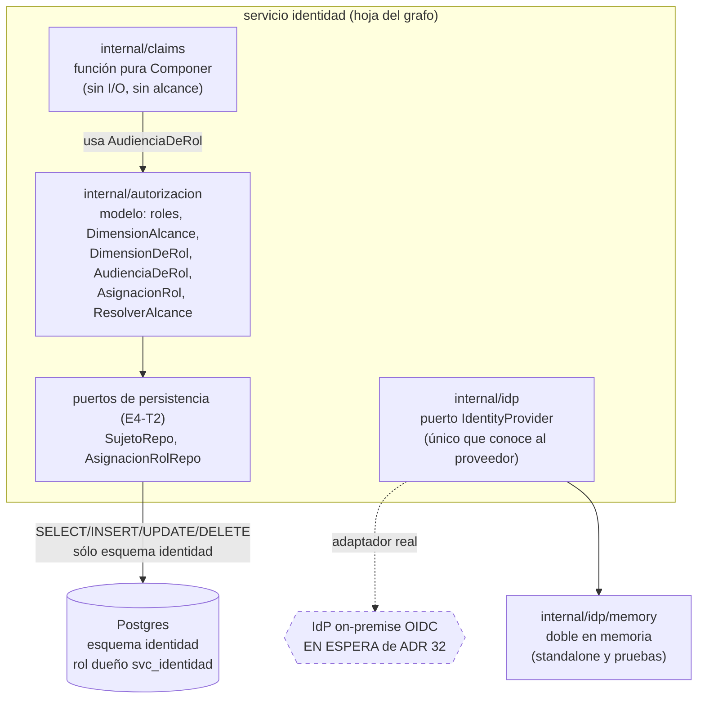

# Design Document

_Modelo de autorización y composición de claims (E4-T2) — servicio `pf-svc-identidad`_

## Overview

Esta feature implementa la historia técnica **E4-T2 — Modelo de autorización: jerarquía de tenant, alcance y `Audiencia`**. El servicio `identidad` es el **dueño del modelo de autorización** de AI27: el catálogo de los ocho roles de DEC-053, la jerarquía de `tenant`, el alcance efectivo en dos dimensiones (DEC-045 #8) y la derivación de la `Audiencia` de dominio (DEC-054).

Dos afirmaciones gobiernan todo el diseño:

1. **`identidad` no decide autorización por petición; compone claims.** La decisión por petición es de cada módulo consumidor, sobre su propia proyección de alcance alimentada por los eventos de `identidad` (`identidad.md` (a)). Lo que esta feature produce es el **modelo persistido** y una **función pura de composición de claims**.
2. **`identidad` es hoja del grafo de dependencias internas.** El IdP on-premise (OIDC; propuesta Keycloak, ADR 32 en estado *Propuesta*) es una dependencia **externa**, no una arista de AI27: queda detrás de un puerto y no aparece en `reglas.yaml` (`identidad.md` (d), (f), (l)). `identidad` es dueño de usuarios cero: no custodia credenciales, contraseñas, segundo factor ni firma —eso es del IdP—.

### Relación scaffold → lógica real

La mayor parte de la **forma** ya existe en el repositorio como scaffold verificado. Este diseño describe lo que ya está y define con precisión lo que E4-T2 **añade** encima (la lógica real sobre esa forma), marcando explícitamente lo que queda **EN ESPERA de ADR 32** o **PENDIENTE de decisión**, sin inventarlo.

| Elemento | Estado hoy (scaffold) | Qué añade E4-T2 |
| --- | --- | --- |
| `internal/claims.Componer` | Función pura completa | Nada: ya satisface Requisitos 5, 6, 7 (parte pura). Se consolida como artefacto probado y versionado |
| `internal/autorizacion` (modelo) | Forma: enum reexportado, `DimensionAlcance`, `DimensionDeRol`, `AudienciaDeRol`, `AsignacionRol`, puerto `ResolverAlcance` | Validación del catálogo de roles; persistencia real de `sujeto` y `asignacion_rol` detrás de puertos; marcado del punto de resolución de alcance (sin implementar el vínculo DEC-045) |
| `internal/idp` (puerto) | Puerto, doble `memory`, suite `idptest` | Nada nuevo en T2: se usa el doble en memoria para standalone (Requisito 10). Adaptador real EN ESPERA de ADR 32 |
| `migrations/identidad/0001_init.sql` | Esquema, rol dueño `svc_identidad`, tablas | Posible refuerzo de constraints de unicidad (decisión de diseño a confirmar, ver Data Models) |

La envoltura que expone `Componer` al IdP real (empaquetado como *mapper* o extensión del IdP, ADR 32 §4) queda **EN ESPERA de ADR 32** y **fuera del alcance de implementación** de esta feature.

### Fuentes

- `docs/arquitectura/services/identidad.md` (a)–(l)
- `docs/historias-tecnicas/E4-identidad-y-acceso.md` (E4-T2)
- `docs/adr/0032-despliegue-v1-on-premise.md` (ADR 32), `docs/adr/0026-revocacion-local-de-sesiones.md` (ADR 26)
- `.kiro/steering/decision-log.md`: DEC-045, DEC-053, DEC-054, DEC-022, DEC-036
- Código verificado: `internal/claims/claims.go`, `internal/autorizacion/port.go`, `internal/idp/port.go`, `internal/gobierno/port.go`, `migrations/identidad/0001_init.sql`

## Architecture

`identidad` separa tres paquetes internos con responsabilidades disjuntas. `claims` es una función pura sin dependencias de I/O. `autorizacion` es dueño del modelo y de los puertos de persistencia. `idp` aísla por completo al proveedor externo. Nada fuera de `idp` conoce al proveedor (§A.5 R2).



Lo que cruza al IdP (verificación de credencial, emisión, refresco, revocación, y el empaquetado de la composición como *mapper*) está marcado con línea discontinua: queda **EN ESPERA de ADR 32**. En T2 ese borde se ejerce sólo contra el doble `internal/idp/memory`.

El **alcance efectivo** (unidad/cliente) se resuelve en servidor y **no viaja en el token** (DEC-053). El puerto `ResolverAlcance` marca el lugar de esa resolución, pero su lógica depende del vínculo Monitorista↔`unidades`, aún **PENDIENTE** (DEC-045, notas), y no se implementa en T2.

## Components and Interfaces

### `internal/claims` — composición pura de claims (ya existe)

Función pura `(tenant, rol) → (tenant, rol, Audiencia)`, idéntica en emisión y refresco (ADR 16 cerrado por DEC-031). El alcance **no** entra en el resultado (DEC-053).

```go
// Entrada: lo que el modelo vigente afirma HOY del sujeto. Sin alcance.
type ModeloVigente struct {
    SujetoID string
    TenantID string
    Rol      autorizacion.Rol
}

// Salida: EXACTAMENTE identidad, tenant, rol y Audiencia. Sin alcance.
type Compuestos struct {
    SujetoID  string
    TenantID  string
    Rol       autorizacion.Rol
    Audiencia auth.Audiencia
}

// Función pura. Deriva la Audiencia del rol (DEC-054); nunca la acepta como
// parámetro (P10). La misma entrada produce la misma salida.
func Componer(m ModeloVigente) Compuestos
```

- **Ya satisface:** Requisito 5 (derivación de `Audiencia`), Requisito 6 (claims exactos, sin alcance), Requisito 7 (recomposición idéntica, parte pura), Requisito 10.2/10.3 (determinismo sin estado externo).
- **E4-T2 añade:** nada en la firma. T2 fija esta función como artefacto probado (unit + PBT) y versionado con el módulo. La envoltura al IdP (ADR 32 §4) queda EN ESPERA.
- **Nota (Requisito 6.3):** la firma toma un **único** `Rol` por construcción; "cero o múltiples roles" no puede ocurrir dentro de `Componer`. La validación de "exactamente un rol vigente" vive **antes**, al **construir** `ModeloVigente` desde el modelo persistido (ver `autorizacion`). Decisión de diseño: esa validación es responsabilidad del cargador del modelo vigente, no de la función pura.

### `internal/autorizacion` — modelo de autorización (forma presente, lógica añadida por T2)

```go
// Enum reexportado del contrato. Fuente única: api-client-go/roles. No se
// redefine aquí (es dato que viaja en el token).
type Rol = roles.Rol

const (
    RolCliente; RolJefeOperativo; RolMonitorista; RolSupervisor
    RolCoordinador; RolEjecutivo; RolReaccion; RolAdministrador
)

// Dos dimensiones de alcance (DEC-045 #8) más global y tenant.
type DimensionAlcance string
const (
    AlcanceUnidad  = "unidad"
    AlcanceCliente = "cliente"
    AlcanceGlobal  = "global"
    AlcanceTenant  = "tenant"
)

// Mapeo puro rol → dimensión durable. jefe_operativo y reaccion devuelven
// ("", false) a propósito: no tienen dimensión durable en T2 (DEC-045, notas).
func DimensionDeRol(r Rol) (DimensionAlcance, bool)

// Deriva la Audiencia de dominio del rol (DEC-054), vía r.EsInterno() del
// contrato. cliente → Cliente; los otros siete → Interno.
func AudienciaDeRol(r Rol) auth.Audiencia

// Forma de una asignación de rol con su dimensión de alcance.
// NO incluye el identificador del recurso de alcance (a qué unidad/cliente):
// esa mecánica está SIN DEFINIR (TODO(DEC-045)).
type AsignacionRol struct {
    SujetoID  string
    TenantID  string
    Rol       Rol
    Dimension DimensionAlcance
}

// Marca el punto donde, EN SERVIDOR, se resolverá el alcance efectivo (DEC-053).
// Lógica EN ESPERA del vínculo DEC-045: devuelve resuelto=false mientras no esté.
type ResolverAlcance interface {
    UnidadesDe(sujetoID string) (unidades []string, resuelto bool)
    ClientesDe(sujetoID string) (clientes []string, resuelto bool)
}
```

- **Ya existe:** todo lo anterior como forma; `DimensionDeRol` y `AudienciaDeRol` ya son totales sobre el enum.
- **E4-T2 añade:**
  - **Validación del catálogo de roles** (Requisito 2): rechazar cualquier `asignacion_rol` cuyo código de rol caiga fuera de los ocho de DEC-053, apoyándose en el `CHECK` de la tabla `rol` y la `FK` de `asignacion_rol.rol_codigo`.
  - **Persistencia real** de `sujeto` y `asignacion_rol` detrás de puertos (ver abajo).
  - **Carga del modelo vigente**: construir `claims.ModeloVigente` a partir del `sujeto` y de su única `asignacion_rol` activa, rechazando el caso de cero o múltiples roles activos (Requisito 6.3).
- **E4-T2 NO implementa:** la lógica de `ResolverAlcance` ni el vínculo Monitorista↔`unidades`. Devuelve `resuelto=false` y marca el lugar. No se inventa tabla ni columna para el vínculo (TODO(DEC-045)).

### Puertos de persistencia que E4-T2 introduce

Siguiendo el estilo Go ("accept interfaces, return structs"), las interfaces se **definen en el consumidor** (en `autorizacion`, que las usa) y la implementación concreta sobre Postgres vive en un subpaquete `internal/`. Son interfaces pequeñas, de un solo propósito.

```go
// SujetoRepo persiste y lee sujetos. Devuelve ErrSujetoDuplicado cuando choca
// una clave de unicidad (idp_subject, o el par (tenant_id, sujeto_id)).
type SujetoRepo interface {
    Crear(ctx context.Context, s Sujeto) (Sujeto, error)
    PorIdpSubject(ctx context.Context, idpSubject string) (Sujeto, bool, error)
}

// AsignacionRolRepo persiste y lee asignaciones de rol. Rechaza roles fuera del
// catálogo (ErrRolFueraDeCatalogo) y asignaciones duplicadas (ErrAsignacionDuplicada).
type AsignacionRolRepo interface {
    Asignar(ctx context.Context, a AsignacionRol) (AsignacionRol, error)
    ActivasDe(ctx context.Context, sujetoID string) ([]AsignacionRol, error)
}

// CargadorModeloVigente arma el ModeloVigente para componer. Rechaza con
// ErrRolNoUnico si el sujeto no tiene exactamente una asignación activa (Req 6.3).
type CargadorModeloVigente interface {
    ModeloVigenteDe(ctx context.Context, sujetoID string) (claims.ModeloVigente, error)
}
```

Las implementaciones concretas aceptan `context.Context` como primer parámetro, propagan errores con `fmt.Errorf("...: %w", err)` y mapean las violaciones de constraint de Postgres a los errores de dominio anteriores.

### `internal/idp` — puerto del proveedor (ya existe; sin cambios en T2)

```go
type Credentials struct { Usuario, Contrasena string }
type Token struct { AccessToken, RefreshToken string; ExpiraEn time.Time }

type IdentityProvider interface {
    Issue(ctx context.Context, cred Credentials) (Token, error)
    Refresh(ctx context.Context, refreshToken string) (Token, error)
    Revoke(ctx context.Context, sesionID string) error
}
```

- **Ya existe:** el puerto, el doble `internal/idp/memory` y la suite de contrato `internal/idp/idptest`.
- **E4-T2 usa, no cambia:** T2 opera en standalone contra el doble en memoria (Requisito 10). El adaptador real y la composición de claims empaquetada como *mapper*/extensión quedan **EN ESPERA de ADR 32**.

### `internal/gobierno` — fuera del alcance de T2

El puerto `Gobierno interface{}` está **vacío a propósito**: la superficie `/api/v1/sujetos`, `/api/v1/roles` y los eventos `sujeto.*`/`rol.*` son una **brecha contractual** (no existen en `pf-pkg-contracts` fijado). Rellenarla a mano violaría la regla 6 (no escribir tipos de wire ni eventos a mano). Pertenece a **E4-T6**, no a T2.

## Data Models

### Tablas del esquema `identidad` (migración `0001_init.sql`)

| Tabla | Columnas clave | Unicidad / integridad |
| --- | --- | --- |
| `sujeto` | `id UUID PK`, `idp_subject TEXT NOT NULL`, `tenant_id UUID NOT NULL`, `activo BOOL`, `creado_en`, `actualizado_en` | `idp_subject` **UNIQUE** (presente) |
| `rol` | `codigo TEXT PK` | `CHECK (codigo IN (ocho roles de DEC-053))`; sin `auditor` (DEC-036) |
| `asignacion_rol` | `id UUID PK`, `sujeto_id → sujeto(id)`, `rol_codigo → rol(codigo)`, `asignado_por`, `asignado_en`, `revocado_por`, `revocado_en` | `FK` a `sujeto` y `rol`; índice parcial `(sujeto_id) WHERE revocado_en IS NULL` |
| `alcance_tenant` | `sujeto_id → sujeto(id)`, `tenant_id`, `creado_en` | `PK (sujeto_id, tenant_id)` |
| `sesion`, `cambio_identidad`, `outbox` | — | Relevantes para T3/T6; fuera del foco de T2 |

El rol dueño `svc_identidad` tiene `USAGE` sólo sobre el esquema `identidad` y `SELECT/INSERT/UPDATE/DELETE` sólo sobre sus tablas; **ningún otro rol** recibe `GRANT` (base de P1, Requisito 9).

### Structs de Go

`claims.ModeloVigente`, `claims.Compuestos` y `autorizacion.AsignacionRol` ya están definidos (ver Components and Interfaces). El `Sujeto` que E4-T2 persiste refleja la tabla `sujeto`:

```go
// Sujeto correlaciona el identificador externo del IdP con el sujeto interno de
// AI27 y su tenant inmutable (P10). identidad NO guarda credenciales.
type Sujeto struct {
    ID         string // id interno de AI27 (UUID)
    IdpSubject string // subject OIDC del IdP; no es la credencial
    TenantID   string
    Activo     bool
}
```

### Decisiones de diseño sobre unicidad (a confirmar)

La propiedad candidata 3 del `requirements.md` exige unicidad de tres claves. Dos de ellas requieren un constraint que la migración **aún no tiene**; se dejan señaladas en vez de inventar columnas:

1. **`idp_subject` UNIQUE** — ya presente en la migración. Verificable hoy (Requisito 1.2).
2. **Par `(tenant_id, sujeto_id)` UNIQUE** (Requisito 1.3) — hoy la tabla sólo tiene `idp_subject UNIQUE` y `id PK`; no hay un `UNIQUE (tenant_id, id)`. **Decisión de diseño a confirmar:** añadir ese constraint en una migración de T2, o declarar que la unicidad del par queda cubierta por `id PK` + `idp_subject UNIQUE` (en cuyo caso el criterio 1.3 se reinterpreta). No se resuelve en silencio.
3. **Terna `(sujeto_id, rol_id, alcance)` UNIQUE** (Requisito 3.2) — hoy `asignacion_rol` **no** tiene esa columna de recurso de alcance (es TODO(DEC-045)) ni un `UNIQUE` sobre `(sujeto_id, rol_codigo)`. **Decisión de diseño a confirmar:** la unicidad exacta de la terna del requisito **no es verificable** mientras el componente "alcance" de la terna dependa del vínculo PENDIENTE. En T2 lo máximo expresable es un `UNIQUE (sujeto_id, rol_codigo) WHERE revocado_en IS NULL` (a lo sumo una asignación activa de un rol por sujeto); la dimensión de alcance se **deriva** del rol (`DimensionDeRol`) y hoy no es columna. No se inventa la columna de alcance para forzar la terma.

## Correctness Properties

_Una propiedad es una característica o comportamiento que debe cumplirse en todas las ejecuciones válidas del sistema: un enunciado formal de lo que el sistema debe hacer. Las propiedades son el puente entre la especificación legible por humanos y las garantías de correctitud verificables por máquina._

El prework clasificó cada criterio de aceptación y consolidó los testables en seis propiedades. Las propiedades 1–3 y 5 son puras (property-based testing sobre funciones y estructuras de Go). La propiedad 4 (unicidad) depende de los constraints de BD y se verifica por integración con generadores. La propiedad 6 (aislamiento P1) es de integración contra Postgres real. Los criterios marcados SMOKE o fuera de alcance (token ya emitido, resolución de alcance, política de `aud`, ownership de esquema) se documentan en Testing Strategy y Scope and Deferrals; no generan propiedad.

### Property 1: Derivación determinista de `Audiencia` = f(rol)

*Para todo* `rol` del catálogo, `AudienciaDeRol(rol)` (y por tanto `Componer`) produce `Cliente` si el rol es `cliente` e `Interno` para los otros siete, y el resultado depende **únicamente** del rol: no existe canal para inyectar una `Audiencia` externa, porque la firma de `Componer` no la admite como parámetro.

- **Generador:** rol uniforme sobre los ocho valores del enum (más roles arbitrarios inválidos para el borde).
- **Oráculo:** tabla fija `{cliente → Cliente, resto → Interno}` (equivale a `rol.EsInterno()` del contrato).

**Validates: Requirements 5.1, 5.2, 5.3, 5.4, 10.2**

### Property 2: Mapeo total y correcto de rol → dimensión de alcance

*Para todo* `rol` del catálogo, `DimensionDeRol(rol)` devuelve: `(unidad, true)` para `monitorista`/`supervisor`/`coordinador`; `(cliente, true)` para `ejecutivo`; `(global, true)` para `administrador`; `(tenant, true)` para `cliente`; y `("", false)` para `jefe_operativo` y `reaccion` (sin dimensión durable, DEC-045 notas). La función es total: cubre los ocho roles sin omisión.

- **Generador:** rol uniforme sobre los ocho valores del enum.
- **Oráculo:** tabla fija del mapeo anterior.

**Validates: Requirements 3.3, 3.4, 3.5, 3.6**

### Property 3: Ausencia de alcance en el token

*Para todo* `ModeloVigente` (con cualquier `SujetoID`, `TenantID` y `rol`), `Componer` produce exactamente los claims `{SujetoID, TenantID, Rol, Audiencia}` y ninguna referencia a `unidad`, a monitoristas o supervisores subordinados, ni a `cliente` asignado. Como el alcance **no es entrada** de `Componer`, ningún cambio de alcance puede alterar su resultado.

- **Generador:** `ModeloVigente` con identificadores y tenant arbitrarios y rol del enum; además, variación arbitraria del "alcance del sujeto" simulada fuera de la entrada para confirmar que no afecta la salida.
- **Oráculo:** igualdad del conjunto de campos de `Compuestos` con el conjunto esperado; estabilidad del resultado ante cambios de alcance externos.

**Validates: Requirements 6.1, 6.2, 8.3**

### Property 4: Unicidad de claves del modelo

*Para todo* par de operaciones de alta sobre la misma clave, la segunda falla por violación de unicidad y no modifica la fila existente: `idp_subject` es único en `sujeto`; el par `(tenant_id, sujeto_id)` es único; y la asignación de rol activa por sujeto es única según el constraint que se confirme (ver Data Models). La parte verificable **hoy** es `idp_subject`; el par compuesto y la asignación activa única dependen de la decisión de diseño señalada.

- **Generador:** `idp_subject`/`tenant_id`/`sujeto_id` arbitrarios, forzando colisiones deliberadas en una fracción de los casos.
- **Oráculo:** el constraint de Postgres (la segunda alta devuelve el error de unicidad mapeado a `ErrSujetoDuplicado`/`ErrAsignacionDuplicada`).

**Validates: Requirements 1.2, 1.3, 3.2**

### Property 5: Recomposición idéntica entre emisión y refresco

*Para todo* `ModeloVigente`, componer en "emisión" y componer en "refresco" produce el mismo conjunto y los mismos valores de claims (determinismo/pureza). *Para todo* `ModeloVigente` y rol `r'` distinto del previo, recomponer con `r'` produce el resultado correspondiente a `r'` sin reutilizar el resultado anterior.

- **Generador:** `ModeloVigente` arbitrario; para la parte metamórfica, un segundo rol distinto del primero.
- **Oráculo:** igualdad estructural de `Compuestos` entre dos invocaciones con la misma entrada; y coherencia de `Rol`/`Audiencia` con el rol vigente tras el cambio.

**Validates: Requirements 7.1, 7.2, 7.3, 10.2**

### Property 6: Aislamiento de esquema por rol de base de datos (P1)

*Para todo* intento de `SELECT` sobre cualquier objeto del esquema `identidad` con un rol de base de datos distinto de `svc_identidad`, la lectura falla con `permission denied for schema`; y una lectura con el rol propio `svc_identidad` tiene éxito.

- **Generador:** conjunto de objetos del esquema `identidad` (tablas) sobre los que se intenta `SELECT`; se recorre con un rol ajeno y con el rol propio.
- **Oráculo:** mensaje de error `permission denied for schema` para el rol ajeno; éxito para el rol propio.

**Validates: Requirements 1.4, 9.2, 9.4**

### Property 7: Rechazo de rol fuera del catálogo

*Para todo* código de rol que **no** sea uno de los ocho de DEC-053, asignar una `asignacion_rol` con ese código falla, no persiste la fila e informa el rechazo por rol fuera del catálogo. Esto cubre el borde `auditor` (DEC-036) como caso del generador de roles inválidos.

- **Generador:** strings arbitrarios de código de rol, excluyendo los ocho válidos (incluyendo explícitamente `auditor` y la cadena vacía).
- **Oráculo:** el `CHECK` de `rol` + la `FK` de `asignacion_rol.rol_codigo` (mapeado a `ErrRolFueraDeCatalogo`).

**Validates: Requirements 2.2, 2.3**

## Testing Strategy

Enfoque dual: **unit tests** para ejemplos concretos y afirmaciones de modelo; **property-based tests** para las propiedades universales anteriores. Se usa una librería de PBT del ecosistema Go (p. ej. `testing/quick` del estándar o `pgregory.net/rapid`), **no** se implementa PBT desde cero. Cada test de propiedad corre un **mínimo de 100 iteraciones** y lleva un comentario que referencia su propiedad de diseño.

Formato de etiqueta en cada test de propiedad:
`// Feature: e4-t2-modelo-autorizacion-claims, Property N: <texto de la propiedad>`

### Unit tests (ejemplos y afirmaciones de modelo)

- `Componer` sobre casos concretos: un `cliente` y un `administrador`, verificando los cuatro claims exactos (Requisitos 5, 6).
- Catálogo de roles: el conjunto de códigos de `rol` es exactamente los ocho de DEC-053, sin `auditor` (Requisitos 2.1, 2.3).
- Persistencia feliz de `sujeto` y `asignacion_rol`: insertar y releer (Requisitos 1.1, 3.1).
- Carga del modelo vigente: cero o múltiples asignaciones activas → `ErrRolNoUnico` antes de componer (Requisito 6.3).
- Afirmaciones de modelo que no son propiedades computables: `Audiencia` de dominio separada del claim técnico `aud` (Requisito 5.5); jerarquía de `tenant` plana sin filas padre/hijo en V1 (Requisitos 4.1, 4.2).

### Property-based tests

Una propiedad de diseño ↔ un test de propiedad:

- **Property 1 → `AudienciaDeRol`/`Componer`:** `Audiencia` determinista = f(rol).
- **Property 2 → `DimensionDeRol`:** mapeo total y correcto rol → dimensión.
- **Property 3 → `Componer`:** ausencia de alcance en el token.
- **Property 4 → `SujetoRepo`/`AsignacionRolRepo`:** unicidad de claves (integración con BD; genera colisiones).
- **Property 5 → `Componer`:** recomposición idéntica emisión/refresco (metamórfica + determinismo).
- **Property 6 → esquema Postgres:** aislamiento P1 (integración).
- **Property 7 → `AsignacionRolRepo`:** rechazo de rol fuera del catálogo (condición de error).

### Pruebas de contrato e integración

- **Puerto IdP (Requisito 10):** ejecutar la suite `internal/idp/idptest` contra el doble `internal/idp/memory`; verificar que el modo standalone no importa SDK del proveedor real ni abre red hacia el IdP real.
- **Persistencia:** integración de `SujetoRepo`/`AsignacionRolRepo` contra Postgres (altas felices, colisiones de unicidad, rol fuera de catálogo).
- **Aislamiento P1 (Requisitos 1.4, 9.2, 9.4):** con un rol ajeno, `SELECT` sobre objetos de `identidad` → `permission denied for schema`; con `svc_identidad`, `SELECT` exitoso (control positivo).

### Fuera del alcance testeable de T2 (SMOKE / diferido)

No generan test de comportamiento en T2 y se documentan en Scope and Deferrals: token ya emitido no se altera hasta el refresco (Requisito 7.4, el token lo posee el IdP); resolución de alcance en servidor (Requisitos 8.1, 8.2, 8.4, dependen del vínculo DEC-045); política de exclusión de `aud` de decisiones (Requisito 5.6, `identidad` no decide por petición); ownership de esquema y ausencia de GRANTs ajenos (Requisitos 9.1, 9.3, verificables como smoke de configuración).

### Verificación Go

Antes de dar por terminado cualquier cambio en Go: `gofmt`/`go fmt`, `go vet`, `go build ./...`, `go test ./...`. Si algún paso no puede correrse por el entorno, se dice explícitamente en vez de afirmar que quedó verificado.

## Scope and Deferrals

### EN ESPERA de ADR 32 (fuera de implementación en esta feature)

- **Adaptador concreto del IdP:** la implementación real de `IdentityProvider` espera a que ADR 32 (en *Propuesta*) elija el componente (Keycloak u otro). En T2 sólo se usa el doble `internal/idp/memory` y la suite `internal/idp/idptest`.
- **Empaquetado de la composición de claims como *mapper* o extensión del IdP (ADR 32 §4):** en producción `Componer` corre en el IdP, no en nuestro proceso. La envoltura que lo expone al IdP elegido queda EN ESPERA. En T2 vive como función pura para probarla y versionarla.

### PENDIENTE de decisión (no se infiere ni se implementa)

- **Contrato de lectura de alcance y sus eventos de cambio (DEC-053):** no se definen tablas, rutas ni eventos de alcance. El puerto `ResolverAlcance` marca el lugar de resolución en servidor y devuelve `resuelto=false`; su lógica no se implementa.
- **Mecánica del vínculo Monitorista↔`unidades` y la jerarquía Supervisor→Monitoristas / Coordinador→Supervisores (DEC-045, notas):** sin definir. **E4-T2 no implementa el vínculo de alcance ni crea columnas o tablas para él.** El TODO(DEC-045) en `asignacion_rol` permanece: no se añade la columna de recurso de alcance.
- **Gobierno `/api/v1/sujetos` y `/api/v1/roles` con eventos `sujeto.*`/`rol.*`:** brecha contractual en `pf-pkg-contracts` fijado. Rellenarla a mano violaría la regla 6. Pertenece a **E4-T6**; el puerto `internal/gobierno.Gobierno` permanece vacío a propósito.

### Decisiones de diseño abiertas (ver Data Models)

- Constraint de unicidad del par `(tenant_id, sujeto_id)` en `sujeto`: añadir en migración de T2 o reinterpretar el criterio 1.3 como cubierto por `id PK` + `idp_subject UNIQUE`.
- Expresión de la terna `(sujeto_id, rol_id, alcance)` de unicidad (Requisito 3.2): en T2 lo máximo expresable es `UNIQUE (sujeto_id, rol_codigo) WHERE revocado_en IS NULL`, porque el componente "alcance" de la terna depende del vínculo PENDIENTE de DEC-045. No se crea la columna de alcance para forzarla.

Estas dos decisiones se confirman con Product Management / el dueño del módulo antes de escribir la migración correspondiente; no se resuelven en silencio.
