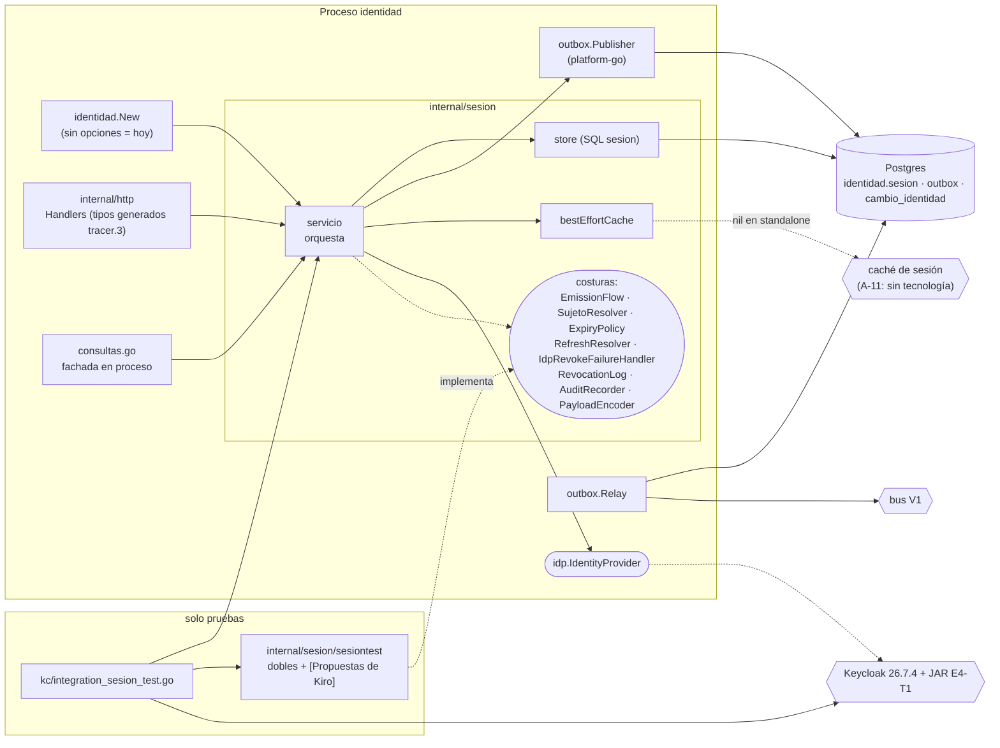
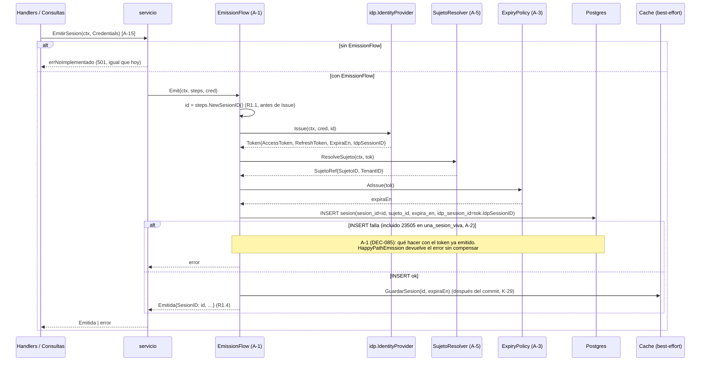
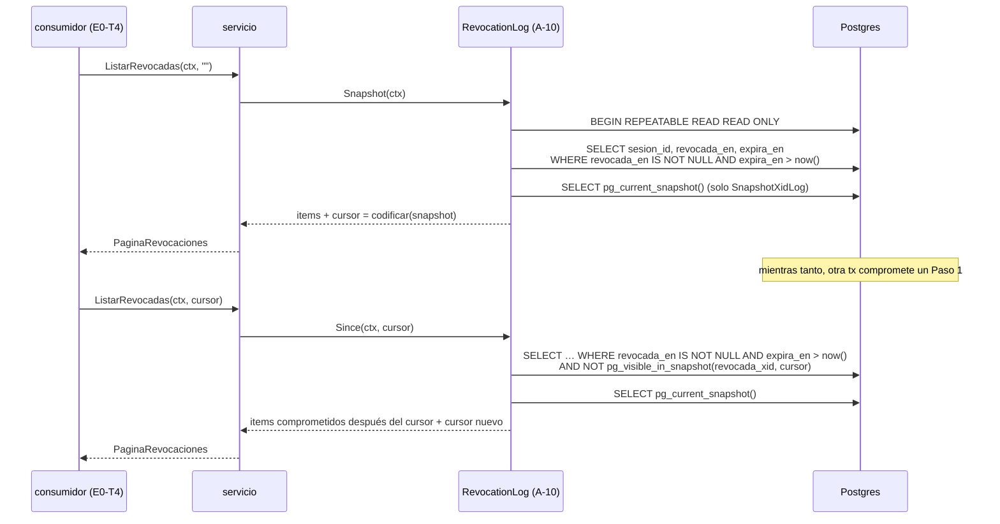

# Design Document

**E4-T3 — Registro de sesión, evento y snapshot de revocación (lado productor `identidad`)** · Documento de diseño

> **Nota de superación (2026-10-16).** Este diseño se redactó el 2026-10-12, ANTES
> de DEC-088. Afirma que "ninguna decisión A-n se resuelve aquí" y que, sin opciones,
> `EmitirSesion`/`RefrescarSesion` "siguen sin cablear (501)", el snapshot "sin cursor"
> y la auditoría "sin escribirse". **Eso describe la Parte A; ya fue superado.**
> **DEC-088 (2026-10-16) resolvió A-1…A-16** y la Parte B está implementada: el login,
> el cursor por timestamp y la auditoría están cableados en `identidad.New`. Para el
> estado vigente, ver `tasks.md` (Parte B) y el código. Este documento se conserva
> como el diseño previo a la decisión; no se reescribe su cuerpo.

| | |
| --- | --- |
| **Estado** | Borrador — pendiente de validación. Ninguna decisión pendiente (A-n) se resuelve aquí _(ver nota de superación arriba: DEC-088 las resolvió)_ |
| **Requisitos** | `requirements.md` de este spec (R1–R10; pendientes A-1…A-16; propuestas K-1…K-40) |
| **Historia técnica** | E4-T3 (`docs/historias-tecnicas/E4-identidad-y-acceso.md`), HU E4-HU-020 |
| **Repositorio** | `repos/pf-svc-identidad`, rama `feature/e4-t3-event-snapshot` (verificada el 2026-10-12) |
| **Contrato** | `pf-pkg-contracts` `v0.1.0-tracer.3` (leído con `git show` sobre el tag; el checkout local del `go.work` está 7 commits adelante) |
| **Fecha** | 2026-10-12 |

Convención del documento, igual que en E4-T1:

- **[Propuesta de Kiro, no aprobada]** marca una elección de Kiro. Ninguna entra a la ruta productiva: vive en código de soporte de pruebas (`internal/sesion/sesiontest`) o como texto, hasta que el owner del pendiente la apruebe.
- **[Decisión pendiente A-n]** marca algo que el diseño no decide. Para cada uno se dan las opciones con sus consecuencias y una **costura** (puerto u opción de construcción) que permite aplicar la decisión sin rehacer el resto.
- Lo que no lleva marca es una decisión de diseño que no toca ninguna regla de producto ni ningún pendiente: refactor interno, corrección de H-1 (pedida por el usuario y por R4.2) o mapeo ya declarado por el contrato (404 de `obtenerSesion`).

## Overview

E4-T3 convierte a `identidad` en la autoridad durable del `sesion_id`. Este diseño cubre solo el **lado productor**; el consumidor es E0-T4 y **E4-T3 no cierra sin E0-T4**.

El diseño hace tres cosas:

1. **Corrige lo que ya está en la ruta productiva** y no depende de ningún pendiente: el Paso 2 de `RevocarSesion` usa el `idp_session_id` leído de la fila en el mismo `UPDATE … RETURNING` del Paso 1 (H-1); `obtenerSesion` responde 404 cuando no hay fila, como declara el contrato; la tabla `sesion` gana la columna `idp_session_id` en una migración nueva `0003`.
2. **Abre costuras** para todo lo que depende de un pendiente (A-1, A-2, A-3, A-4, A-5, A-7, A-10, A-11, A-12, A-14, A-15, A-16). Sin opciones configuradas, `identidad.New` construye el mismo servicio que hoy: `EmitirSesion` y `RefrescarSesion` siguen sin cablear (`errNoImplementado`, HTTP 501), el snapshot sigue sin cursor y la auditoría sigue sin escribirse.
3. **Define las pruebas** de R9 (contra Keycloak 26.7.4) y R10 (contra Postgres), con las implementaciones provisionales que necesitan en un paquete de soporte de pruebas que ningún paquete productivo puede importar (regla nueva de `internal/archtest`).

### Hallazgos de la lectura del código que condicionan el diseño

Verificados leyendo el código y los artefactos el 2026-10-12.

| # | Hallazgo | Consecuencia |
| --- | --- | --- |
| H-1 | `RevocarSesion` llama `s.idp.Revoke(ctx, sesionID)` con el `sesion_id` de AI27. En `kc/revoke.go`, un `DELETE /sessions/{id}` con un id que Keycloak no conoce responde 404 y el adaptador lo trata como **éxito idempotente** | El error de H-1 es **silencioso**: con Keycloak real, el Paso 2 "tiene éxito" y la sesión del IdP queda viva. Por eso la Propiedad 5 verifica el argumento de `Revoke`, no solo el resultado |
| H-2 | `memory.Issue` ignora el `sesionID` y devuelve `IdpSessionID = "memory-sid-<uuid>"`, que **no** es un UUID | La columna `idp_session_id` es `TEXT`, no `UUID`. El doble no sirve para verificar R2.4 (K-11); eso lo cubre R9.1 |
| H-3 | `deploy/keycloak/realm-ai27.json` declara `defaultClientScopes: ["ai27-claims"]` y ese scope no tiene `oidc-sid-mapper`. Keycloak 26 emite `sid` desde el scope `basic`, que el cliente `ai27-login` no tiene | **No verificado** que el access token traiga `sid`. Si no lo trae, R9.2 ("igual al claim `sid`") no tiene oráculo. Ver bloqueante B-10 |
| H-4 | `escribirError` traduce un error sin categoría a 501 `no_implementado`. `ErrNoEncontrada`, un fallo del Paso 1 y un fallo del Paso 2 salen hoy como 501 | El 404 de R6.2 se resuelve envolviendo `ErrNoEncontrada` en un `PlatformError` de categoría `NoEncontrado`. Lo demás queda en A-7 y K-19 |
| H-5 | El `UPDATE … WHERE revocada_en IS NULL` del Paso 1 no distingue "ya revocada" de "inexistente". Hoy, en los dos casos, el código hace commit vacío **y llama al Paso 2** | Con la corrección de H-1, una sesión inexistente no tiene `idp_session_id`, así que el Paso 2 no puede correr. El Paso 1 pasa a clasificar el resultado en tres casos |
| H-6 | `revocada_en = now()` es la hora de **inicio** de la transacción en Postgres, no la del commit | Un cursor por marca de tiempo (o por secuencia) deja huecos con transacciones concurrentes. Relevante para A-10 |
| H-7 | En `identidad.yaml` (`tracer.3`) solo `emitirSesion` declara `security: []`. `refrescarSesion` hereda el `security: [bearerCognito]` global, pero `identidad.go` lo monta como ruta pública | Brecha contractual nueva; se lista en §Brechas. No se cambia el montaje |
| H-8 | `rutaJARExtension` (suite de E4-T1) hace `t.Skipf` si falta el JAR | R9.6 y R9.7 solo admiten omitir por Docker no disponible. La prueba nueva usa una variante estricta; la de E4-T1 no se toca |
| H-9 | `internal/dbtest` omite con `t.Skip` si falta `IDENTIDAD_TEST_DB` | R9 no puede usar `dbtest` tal cual (R9.6). R10 sí, como `TestRevocarYLeer` |
| H-10 | La regla C de `internal/archtest` (literales de Keycloak) solo recorre `internal/idp`, fuera de `internal/idp/internal`. `verifyNoEnvAccess` no es recursivo (solo ve `doc.go`) | Un literal de Keycloak en `internal/sesion` **no** lo detecta archtest. El aislamiento de E4-T1 R2.1 en este spec se garantiza por diseño (§Dónde vive la prueba del Requisito 9) |
| H-11 | `outbox.Publisher.Publish` hace `json.Marshal(ev.Payload)`; un `json.RawMessage` pasa intacto. `protojson` por omisión emite nombres `lowerCamelCase` (`sesionId`) | La opción (b) de A-14 no requiere cambiar `pf-pkg-platform-go`, pero exige `UseProtoNames: true` |
| H-12 | `eventosv1.SesionRevocada` usa `*timestamppb.Timestamp`. `encoding/json` no decodifica el JSON actual en ese tipo; `protojson` sí (acepta nombres proto y RFC 3339) | El contract test (R10.6) decodifica con `protojson`. Agrega `google.golang.org/protobuf` como dependencia directa de prueba, en la versión que ya fija `api-client-go` (`v1.36.12`) |
| H-13 | `0002_grants.sql` pide que toda **tabla** nueva declare sus GRANT y entre a `grants_integration_test.go`. Una columna nueva hereda los privilegios de tabla | La migración `0003` no necesita GRANT. Cualquier opción de A-7 que agregue tabla sí |
| H-14 | `pf-pkg-platform-go/auth` expone `ClaimsFromContext`, y `Claims.Raw` trae los claims crudos. El `sub` es el id de Keycloak, no `sujeto.id` (DEC-072 opción c) | El actor de A-12 sale del contexto, pero requiere resolver `IdpSubject → sujeto.id` |
| H-15 | `autorizacion/postgres.SujetoRepo` recibe `*pgx.Conn`, no un pool ni un `pgx.Tx` | Los resolvedores de sujeto de este diseño consultan con su propio `BeginTx`; no reutilizan ese repo tal cual |
| H-16 | El `go.work` resuelve `pf-pkg-platform-go` al checkout local, que solo tiene el tag `v0.1.0` | Lo citado de `outbox` y `errors` se leyó del checkout local; no se pudo comparar contra `v0.1.1` |

## Architecture

### Paquetes

```
internal/sesion/
├── port.go           # Servicio, Emitida, Estado, Tombstone, PaginaRevocadas (+ Credentials, A-15)
├── deps.go           # BeginTx, Cache (sin cambios de firma)
├── seams.go          # NUEVO: puertos de las costuras (A-1, A-3, A-4, A-5, A-7, A-10, A-12/A-16, A-14)
├── options.go        # NUEVO: Option y With… (construcción; sin opciones = comportamiento de hoy)
├── errors.go         # NUEVO: errores centinela y su envoltura en la taxonomía de plataforma
├── servicio.go       # orquestación; Paso 1 clasifica, Paso 2 usa idp_session_id de la fila
├── store.go          # NUEVO: SQL de la tabla sesion (sin lógica de decisión)
├── cache.go          # NUEVO: envoltura best-effort de Cache
├── payload.go        # NUEVO: codificador por omisión del payload (comportamiento de hoy)
├── *_test.go         # unitarias y PBT sin Postgres
├── *_integration_test.go  # Prueba_Productor contra Postgres (dbtest, como TestRevocarYLeer)
└── sesiontest/       # NUEVO: soporte de pruebas. Dobles y las [Propuestas de Kiro] provisionales.
                      #        Ningún paquete productivo lo importa (archtest, regla E)
internal/idp/internal/kc/
└── integration_sesion_test.go  # NUEVO (//go:build integration): Prueba_Integracion_Keycloak (R9)
migrations/identidad/
└── 0003_sesion_idp_session_id.sql  # NUEVO
internal/archtest/
└── isolation_test.go # + regla E: sesiontest fuera de la ruta productiva
```

### Diagrama de componentes



Las costuras que `identidad.New` no configura quedan vacías; cada método del servicio comprueba si tiene lo que necesita y, si no, responde lo mismo que hoy. Esto mantiene la ruta productiva igual salvo en lo que este diseño corrige sin depender de pendientes (H-1, 404, migración `0003`).

### Secuencia: emisión (camino exitoso, idéntico en las opciones 1 y 2 de DEC-085)

Solo se ejecuta con un `EmissionFlow` configurado. En producción no hay ninguno hasta A-1 (`EmitirSesion` devuelve `errNoImplementado`). En pruebas se usa `sesiontest.HappyPathEmission` **[Propuesta de Kiro, no aprobada]**.



### Secuencia: refresco

Solo con `RefreshResolver` y un modo de refresco de sesión revocada configurados (A-4). En producción, ninguno.

```mermaid
sequenceDiagram
  participant S as servicio
  participant I as idp.IdentityProvider
  participant RR as RefreshResolver (A-4)
  participant P as ExpiryPolicy (A-3)
  participant DB as Postgres
  S->>I: Refresh(ctx, refreshToken)
  alt error del IdP
    I-->>S: ErrRefreshInvalido | ErrProveedorNoDisponible  (K-15: sin tocar filas)
  else ok
    I-->>S: Token nuevo
    S->>RR: SesionIDFor(ctx, tok)
    RR-->>S: sesion_id
    S->>DB: BEGIN; SELECT … FOR UPDATE WHERE sesion_id
    alt fila revocada y modo = Reject (A-4)
      S->>DB: ROLLBACK
      S-->>S: error; el token NO se devuelve
    else fila viva (o modo = DelegateToIdP)
      S->>DB: UPDATE expira_en = P.AtRefresh(actual, tok)  (sin INSERT, R3.2)
      S->>DB: COMMIT
      S-->>S: Emitida{SesionID: sesion_id de la fila}  (R3.1)
    end
  end
```

### Secuencia: revocación en dos pasos (con la corrección de H-1)

Esta secuencia sí es productiva.

```mermaid
sequenceDiagram
  participant H as Handlers / Consultas
  participant S as servicio
  participant DB as Postgres
  participant O as outbox.Publisher
  participant A as AuditRecorder (A-12/A-16)
  participant C as Cache
  participant I as idp.IdentityProvider
  participant FH as IdpRevokeFailureHandler (A-7)
  H->>S: RevocarSesion(ctx, sesion_id)
  S->>DB: BEGIN
  S->>DB: UPDATE sesion SET revocada_en = now()<br/>WHERE sesion_id=$1 AND revocada_en IS NULL<br/>RETURNING revocada_en, expira_en, idp_session_id, sujeto_id
  alt una fila (estaba viva)
    S->>O: Publish(tx, sesion.revocada{sesion_id, revocada_en, expira_en})
    opt AuditRecorder configurado
      S->>A: RecordRevocation(ctx, tx, …)
    end
  else cero filas
    S->>DB: SELECT revocada_en, idp_session_id WHERE sesion_id=$1
    Note over S,DB: ya revocada (sin evento nuevo, R4.7) | inexistente (A-8)
  end
  S->>DB: COMMIT   (Paso 1; si falla: error, sin Paso 2, R4.4)
  S->>C: InvalidarSesion (best-effort, comportamiento actual, K-8)
  alt inexistente
    S-->>H: nil (204, comportamiento actual; A-8)
  else idp_session_id nulo o vacío
    S->>FH: OnFailure(pend, ErrMissingIdpSessionID)
    Note over S,I: nunca Revoke(sesion_id)
  else
    S->>I: Revoke(ctx, idp_session_id DE LA FILA)   (Paso 2, R4.2)
    alt error
      S->>FH: OnFailure(pend{sesion_id, idp_session_id}, causa)  (A-7)
      Note over S,DB: el Paso 1 no se revierte (R4.5)
    end
  end
  S-->>H: nil | error
```

### Secuencia: lectura durable

```mermaid
sequenceDiagram
  participant H as Handlers
  participant S as servicio
  participant DB as Postgres
  H->>S: ObtenerSesion(ctx, sesion_id)
  S->>DB: SELECT revocada_en, expira_en FROM sesion WHERE sesion_id=$1
  alt sin fila
    S-->>H: PlatformError{NoEncontrado, Err: ErrNoEncontrada}
    H-->>H: 404 gen.Error  (R6.2; hoy 501)
  else fila
    S-->>H: Estado{revocada = revocada_en != null, revocada_en, expira_en}  (R6.1)
  end
  Note over S: la caché no participa (R8.2)
```

### Secuencia: snapshot y continuación con cursor

`RevocationLog` es la costura de A-10. En producción se usa el comportamiento de hoy (`snapshotOnlyLog`: snapshot sin cursor; un cursor recibido se ignora y se devuelve el snapshot completo). En pruebas se usa `sesiontest.SnapshotXidLog` **[Propuesta de Kiro, no aprobada]**.



## Components and Interfaces

Identificadores en inglés salvo sustantivos de dominio (`sesion`, `sujeto`, `cambio_identidad`). `idp_session_id` va en inglés (DEC-083 nota 4). Los nombres existentes en español (`Emitida`, `Estado`, `ErrNoEncontrada`, `EmitirSesion`, …) se conservan para no romper llamadores; `naming-conventions.md` §6 no exige un barrido.

### Puerto del servicio: `internal/sesion/port.go`

```go
// Credentials es la credencial que el sujeto presenta al emitir una sesión.
// [Propuesta de Kiro, no aprobada — A-15]. Agrupa los campos para que agregar
// el segundo factor no cambie la firma de EmitirSesion. El handler HTTP solo
// puede llenar Usuario y Contrasena: CredencialesEntrada (tracer.3) no tiene
// campo de segundo factor y declara additionalProperties: false (brecha).
type Credentials struct {
	Usuario       string
	Contrasena    string
	SegundoFactor string
}

type Servicio interface {
	// EmitirSesion. Sin EmissionFlow configurado devuelve errNoImplementado
	// (comportamiento de hoy). Si A-15 se rechaza, se conserva la firma actual
	// (usuario, contrasena string) y R9.1–R9.3 quedan bloqueados.
	EmitirSesion(ctx context.Context, cred Credentials) (Emitida, error)
	RefrescarSesion(ctx context.Context, refreshToken string) (Emitida, error)
	RevocarSesion(ctx context.Context, sesionID string) error
	ObtenerSesion(ctx context.Context, sesionID string) (Estado, error)
	ListarRevocadas(ctx context.Context, cursor string) (PaginaRevocadas, error)
}
```

`RevocarSesion` conserva su firma: `consultas.go` la expone con la forma de `bff.IdentidadPort`, que declara el consumidor. Cómo llegan el actor y el motivo es A-12 (§Costura A-12).

### Construcción: `internal/sesion/options.go`

```go
// NewServicio conserva sus cuatro parámetros. Sin opciones, el servicio se
// comporta como hoy, salvo la corrección de H-1 y el 404 de ObtenerSesion.
func NewServicio(prov idp.IdentityProvider, tx BeginTx, pub *outbox.Publisher, cache Cache, opts ...Option) Servicio

// Option configura una costura del servicio.
type Option func(*servicio)

func WithIDGenerator(gen func() string) Option              // R1; por omisión uuid.NewString (v4). K-10 abierto
func WithEmissionFlow(f EmissionFlow) Option                // A-1 (DEC-085)
func WithSujetoResolver(r SujetoResolver) Option            // A-5
func WithExpiryPolicy(p ExpiryPolicy) Option                // A-3
func WithRefresh(r RefreshResolver, m RevokedRefresh) Option // A-4
func WithIdpRevokeFailureHandler(h IdpRevokeFailureHandler) Option // A-7
func WithRevocationLog(l RevocationLog) Option              // A-10
func WithAuditRecorder(a AuditRecorder) Option              // A-12, A-16
func WithPayloadEncoder(e PayloadEncoder) Option            // A-14
func WithCacheTimeout(d time.Duration) Option               // K-31; cero = solo el ctx del llamador
```

`identidad.New` no pasa ninguna opción. Para cablear una decisión aprobada basta con agregar la opción en `identidad.New`; el resto del servicio no cambia.

### Costuras: `internal/sesion/seams.go`

Cada interfaz es pequeña y está definida en el consumidor (`internal/sesion`), como pide la guía de Go del workspace.

```go
// SesionRecord es la fila que se registra en la emisión.
type SesionRecord struct {
	SesionID     string
	SujetoID     string
	EmitidaEn    time.Time // K-13: qué instante es, abierto
	ExpiraEn     time.Time // A-3
	IdpSessionID string    // idp.Token.IdpSessionID, sin transformar
}

// SujetoRef es el sujeto de AI27 al que pertenece una sesión.
type SujetoRef struct {
	SujetoID string
	TenantID string
}

// EmissionSteps son los pasos atómicos que el servicio ya sabe ejecutar. El
// EmissionFlow decide el ORDEN y la compensación (A-1).
type EmissionSteps interface {
	NewSesionID() string
	Issue(ctx context.Context, cred Credentials, sesionID string) (idp.Token, error)
	ResolveSujeto(ctx context.Context, tok idp.Token) (SujetoRef, error)
	ExpiresAtIssue(tok idp.Token) (time.Time, error)
	Register(ctx context.Context, r SesionRecord) error
	// Compensate termina en el IdP la sesión de un token que no se pudo registrar.
	// Lo usaría la opción 1 de DEC-085; ningún flujo productivo lo llama hoy.
	Compensate(ctx context.Context, idpSessionID string) error
	WarmCache(ctx context.Context, r SesionRecord) // best-effort; nunca falla
}

// EmissionFlow fija el orden emisión↔registro (A-1, DEC-085).
type EmissionFlow interface {
	Emit(ctx context.Context, steps EmissionSteps, cred Credentials) (Emitida, error)
}

// SujetoResolver obtiene el sujeto de AI27 de una emisión (A-5) y su tenant (A-16).
type SujetoResolver interface {
	ResolveSujeto(ctx context.Context, tok idp.Token) (SujetoRef, error)
}

// ExpiryPolicy fija el expira_en de la fila (A-3).
type ExpiryPolicy interface {
	AtIssue(tok idp.Token) (time.Time, error)
	AtRefresh(current time.Time, tok idp.Token) (time.Time, error)
}

// RefreshResolver identifica la fila de la sesión refrescada (A-4).
type RefreshResolver interface {
	SesionIDFor(ctx context.Context, tok idp.Token) (string, error)
}

// RevokedRefresh responde la pregunta abierta de A-4.
type RevokedRefresh int

const (
	RevokedRefreshUndecided     RevokedRefresh = iota // RefrescarSesion no se cablea
	RevokedRefreshReject                              // identidad rechaza y no devuelve el token
	RevokedRefreshDelegateToIdP                       // se deja al IdP tras el Paso 2
)

// PendingIdpRevocation identifica un Paso 2 que no terminó.
type PendingIdpRevocation struct {
	SesionID     string
	IdpSessionID string // vacío si la fila no lo tiene
}

// IdpRevokeFailureHandler decide qué pasa cuando el Paso 2 falla o no puede
// ejecutarse (A-7). Nunca revierte el Paso 1. Lo que devuelve es lo que recibe
// el llamador de RevocarSesion.
type IdpRevokeFailureHandler interface {
	OnFailure(ctx context.Context, p PendingIdpRevocation, cause error) error
}

// RevocationLog entrega snapshot y continuación (A-10).
type RevocationLog interface {
	Snapshot(ctx context.Context) (PaginaRevocadas, error)
	Since(ctx context.Context, cursor string) (PaginaRevocadas, error)
}

// RevocationAudit es lo que la auditoría local registra por revocación (ADR 26 §7).
type RevocationAudit struct {
	SesionID   string
	SujetoID   string
	TenantID   *string // A-16
	ActorID    *string // A-12
	Motivo     *string // A-12
	RevocadaEn time.Time
}

// AuditRecorder escribe en cambio_identidad. Recibe la tx del Paso 1 para que
// la decisión de K-6 (misma tx o aparte) no cambie la firma.
type AuditRecorder interface {
	RecordRevocation(ctx context.Context, tx pgx.Tx, a RevocationAudit) error
}

// PayloadEncoder serializa el payload de sesion.revocada (A-14).
type PayloadEncoder func(t Tombstone) (json.RawMessage, error)
```

### Servicio: `internal/sesion/servicio.go`

#### `RevocarSesion` (productivo)

Pseudocódigo. El Paso 1 devuelve lo que necesita el Paso 2; el Paso 2 nunca recibe el `sesion_id`.

```go
type step1Kind int

const (
	step1Revoked        step1Kind = iota // la fila estaba viva y se marcó
	step1AlreadyRevoked                  // ya tenía revocada_en
	step1NotFound                        // no hay fila
)

type step1Result struct {
	Kind         step1Kind
	IdpSessionID string // "" si es NULL o no hay fila
	Tombstone    Tombstone
}

func (s *servicio) RevocarSesion(ctx context.Context, sesionID string) error {
	res, err := s.revocarLocalConEvento(ctx, sesionID) // Paso 1
	if err != nil {
		return err // R4.4: no hubo commit; no se llama al Paso 2
	}
	s.cache.invalidate(ctx, sesionID) // best-effort, comportamiento actual (K-8)

	if res.Kind == step1NotFound {
		return nil // comportamiento actual: 204. A-8 decide si pasa a 404
	}
	pend := PendingIdpRevocation{SesionID: sesionID, IdpSessionID: res.IdpSessionID}
	if res.IdpSessionID == "" {
		return s.onIdpRevokeFailure(ctx, pend, ErrMissingIdpSessionID) // nunca Revoke(sesionID)
	}
	// step1AlreadyRevoked también llega aquí: hoy el código repite el Paso 2 en
	// cada DELETE y este diseño conserva ese comportamiento (coincide con K-17,
	// que sigue abierto; la costura es este mismo punto).
	if err := s.idp.Revoke(ctx, res.IdpSessionID); err != nil { // Paso 2
		return s.onIdpRevokeFailure(ctx, pend, err) // A-7; el Paso 1 queda
	}
	return nil
}

// onIdpRevokeFailure sin handler configurado devuelve el error envuelto, igual
// que hoy (el handler HTTP lo sigue sacando como 501 hasta A-7).
func (s *servicio) onIdpRevokeFailure(ctx context.Context, p PendingIdpRevocation, cause error) error {
	if s.revokeFailure == nil {
		return fmt.Errorf("%w: %w", ErrIdpRevokePending, cause)
	}
	return s.revokeFailure.OnFailure(ctx, p, cause)
}
```

`revocarLocalConEvento` (Paso 1), en una sola transacción:

```sql
-- (1) marca solo si está viva; devuelve lo que necesitan el evento y el Paso 2
UPDATE identidad.sesion
   SET revocada_en = now()
 WHERE sesion_id = $1 AND revocada_en IS NULL
RETURNING revocada_en, expira_en, idp_session_id, sujeto_id;

-- (2) solo si (1) no devolvió filas: clasificar
SELECT revocada_en, idp_session_id FROM identidad.sesion WHERE sesion_id = $1;
```

- Con fila en (1): `Publish(ctx, tx, outbox.Event{Tipo: "sesion.revocada", Version: 1, AgregadoID: sesionID, Sensibilidad: SensibilidadAmplia, Payload: encoder(tombstone)})`. Después, si hay `AuditRecorder`, `RecordRevocation(ctx, tx, …)`. Después, `COMMIT`.
- Sin fila en (1): `COMMIT` sin evento (R4.7). (2) clasifica `step1AlreadyRevoked` o `step1NotFound`.
- Dos revocaciones concurrentes del mismo `sesion_id` se serializan por el bloqueo de fila del `UPDATE`. En `READ COMMITTED` la segunda reevalúa el `WHERE`, no marca y no emite. Es una observación, no una regla: K-4 sigue abierta.

El `Tipo` y la `Version` del evento no se escriben como cadena libre en dos lugares: se declaran una vez como constantes del paquete con el valor de `registro.tipos.yaml` (`sesion.revocada`, v1). El contract test (R10.6) verifica ese valor contra el contrato.

#### `ObtenerSesion` (productivo)

Misma consulta que hoy. Lo único que cambia es el error: `&platformerrors.PlatformError{Category: CategoryNoEncontrado, Message: "sesión no encontrada", Err: ErrNoEncontrada}`. `errors.Is(err, ErrNoEncontrada)` sigue siendo verdadero por `Unwrap`, y la categoría llega igual al handler HTTP y a la fachada en proceso (paridad I3 de ADR 17). Así se cumple R6.2 sin tocar `escribirError`.

#### `ListarRevocadas`

```go
func (s *servicio) ListarRevocadas(ctx context.Context, cursor string) (PaginaRevocadas, error) {
	if cursor == "" {
		return s.log.Snapshot(ctx)
	}
	return s.log.Since(ctx, cursor)
}
```

Por omisión, `s.log` es `snapshotOnlyLog`, con la consulta de hoy (`revocada_en IS NOT NULL AND expira_en > now()`). Su `Since` ignora el cursor y devuelve el snapshot completo, igual que hoy, con `CursorSiguiente` nulo. R7.2 y R7.3 no se cumplen en la ruta productiva hasta A-10.

#### `EmitirSesion` y `RefrescarSesion`

- `EmitirSesion`: si falta `EmissionFlow`, `SujetoResolver` o `ExpiryPolicy`, devuelve `errNoImplementado`. Si están, delega en `flow.Emit(ctx, steps, cred)`, donde `steps` es una implementación interna de `EmissionSteps` sobre el `idp`, el `store` y la caché.
- `RefrescarSesion`: si falta `RefreshResolver`, `ExpiryPolicy` o el modo es `RevokedRefreshUndecided`, devuelve `errNoImplementado`. Si están, sigue la secuencia de refresco.

### Caché: `internal/sesion/cache.go`

```go
// bestEffortCache envuelve Cache. Nunca devuelve error al servicio y nunca se
// consulta para decidir estado: Cache no tiene método de lectura (R8.2).
type bestEffortCache struct {
	c       Cache         // nil = sin caché (comportamiento actual; K-3 abierta)
	timeout time.Duration // K-31; cero = solo el ctx del llamador
}

func (b bestEffortCache) store(ctx context.Context, sesionID string, expiraEn time.Time)
func (b bestEffortCache) invalidate(ctx context.Context, sesionID string)
```

Los errores de la caché se descartan con un comentario explícito y se cuentan en una métrica (propuesta, mismo patrón que E4-T1 R10; nombre no fijado). Con `timeout` en cero, una caché que no responde bloquea hasta que venza el `ctx` del llamador: R8.3 en su parte de "no responde" queda **condicionado a K-31/A-11**. El puerto `Cache` y su contenido (`sesionID`, `expiraEn`) no cambian; la tecnología, el TTL y el adaptador son A-11 y **no se agrega cliente de Redis a `go.mod`**.

### Handlers HTTP: `internal/http/handlers.go`

- `EmitirSesion`: construye `sesion.Credentials{Usuario, Contrasena}` desde `gen.CredencialesEntrada`. `SegundoFactor` queda vacío porque el contrato no lo transporta.
- `ObtenerSesion`: sin cambios; el 404 sale de `escribirError` porque el error ya trae la categoría.
- `RevocarSesion`, `ListarSesionesRevocadas`, `RefrescarSesion`: sin cambios.
- No se crean rutas ni tipos de wire. Las cinco operaciones y sus tipos siguen saliendo de `api-client-go/identidad` (`tracer.3`).

### Soporte de pruebas: `internal/sesion/sesiontest`

Paquete normal, sin build tag, para que lo usen tanto las pruebas de `go test ./...` como las de `-tags integration`. Todo lo marcado **[Propuesta de Kiro, no aprobada]** existe solo aquí.

| Elemento | Qué es | Marca |
| --- | --- | --- |
| `RecordingIdP` | Envoltura de `idp.IdentityProvider` que registra cada argumento de `Revoke` y puede fallar a demanda. Antes de devolver, ejecuta un *hook* que permite consultar Postgres desde otra conexión (R4.3) | Doble |
| `FailingCache`, `RecordingCache` | `Cache` que siempre falla / que registra llamadas | Doble |
| `FaultyBeginTx` | `BeginTx` cuya `pgx.Tx` falla en el paso k (Begin, `UPDATE`, `INSERT` de outbox, `COMMIT`) | Doble |
| `HappyPathEmission` | `EmissionFlow`: id → `Issue` → sujeto → expiración → `Register` → caché. Si `Register` falla, devuelve el error **sin compensar**. No es ninguna opción de DEC-085 | [Propuesta de Kiro, no aprobada] |
| `SujetoBySub` | `SujetoResolver`: lee `sub` del access token con un `auth.Authenticator` y busca `sujeto` por `idp_subject`. El tenant sale de `sujeto.tenant_id` | [Propuesta de Kiro, no aprobada] |
| `LatestTokenExpiry` | `ExpiryPolicy` opción (b) de A-3: `AtIssue = tok.ExpiraEn`; `AtRefresh = max(actual, tok.ExpiraEn)` | [Propuesta de Kiro, no aprobada] |
| `RefreshByClaim` | `RefreshResolver` opción (a) de A-4: `sesion_id` del claim del access token nuevo | [Propuesta de Kiro, no aprobada] |
| `SnapshotXidLog` + `ApplyCursorTestDDL` | `RevocationLog` por visibilidad de snapshot de Postgres y el DDL de prueba que necesita (columna + trigger), aplicado **solo** en la base de prueba | [Propuesta de Kiro, no aprobada] |
| `ProtoPayload` | `PayloadEncoder` opción (b) de A-14 | [Propuesta de Kiro, no aprobada] |

**Regla E nueva en `internal/archtest`:** ningún paquete importa `…/internal/sesion/sesiontest` desde su lista `Imports` (código no de prueba), salvo el propio `sesiontest`. Hoy `listPackages` mezcla `Imports`, `TestImports` y `XTestImports` en un solo campo; la regla necesita conservar `Imports` aparte. Con esto, "fuera de la ruta productiva" queda verificado por `go test ./...`, no supuesto.

### Dónde vive la prueba del Requisito 9 y su arnés

R9 ejercita el Servicio_Sesion contra Keycloak. El arnés (`arranqueKeycloak`, `codigoTOTPFresco`, `emitirConTOTP`, `subPorUsuario`) está en archivos `_test.go` del paquete `kc`, bajo `internal/idp/internal`. Por la regla `internal` de Go solo se importa desde `internal/idp/...`, y ningún paquete importa archivos `_test.go` de otro. E4-T1 R2.1 pide además que todo código que construye peticiones a Keycloak, pruebas incluidas, viva en ese árbol.

| Opción | Cómo | Aislamiento E4-T1 R2.1 / archtest | Costo |
| --- | --- | --- | --- |
| **(1) Prueba en el paquete `kc`** | `internal/idp/internal/kc/integration_sesion_test.go`, `//go:build integration`, `package kc`. Reutiliza el arnés directamente; importa `internal/sesion`, `internal/sesion/sesiontest` y `migrations` | Cumple: los literales, el contenedor y el cliente de administración se quedan en `internal/idp/internal`. Sin ciclo: `sesion` no importa `kc`. archtest no cambia | Una prueba del servicio de sesión vive en el paquete del adaptador. La suite de E4-T1 compila contra `internal/sesion` con `-tags integration` |
| (2) Arnés exportado + fachada | Mover el arnés a `kc/harness_integration.go` (`//go:build integration`, no `_test`) y exponerlo por `internal/idp/keycloaktest` (sin literales). La prueba vive en `internal/sesion` | Cumple si la fachada no tiene literales (regla C) | Superficie nueva bajo `internal/idp`; mueve código de prueba de E4-T1 a archivos que compilan con el tag; más archivos que mantener |
| (3) Prueba en `internal/sesion` con su propio Keycloak | Contenedor y URLs de Keycloak escritos en `internal/sesion` | **Viola E4-T1 R2.1.** archtest no lo detectaría (H-10), lo que lo hace peor | — |

**Recomendación: (1).** No crea superficie nueva, no mueve código de E4-T1 y deja todo el conocimiento de Keycloak en un solo árbol. El costo de cohesión se documenta en el encabezado del archivo. Si el equipo prefiere que la prueba viva junto al servicio, (2) es la alternativa válida.

Piezas nuevas del arnés, todas dentro de `kc` y en archivos `_test.go` con el tag:

- `rutaJARExtensionEstricta`: igual que `rutaJARExtension`, pero sin el JAR hace `t.Fatalf("arranque keycloak: …")` (R9.7, H-8). La función de E4-T1 no cambia.
- `arranquePostgres(t)`: `testcontainers.GenericContainer` con `postgres:16-alpine` (la imagen que ya usa `autorizacion/postgres`). Reutiliza la verificación de Docker de `arranqueKeycloak` (`NewDockerProvider` + `Health` → `t.Skip`, R9.6). Cualquier otra falla es `t.Fatalf("arranque postgres: …")` (R9.7). Aplica todas las migraciones de `migrations.FS` como administrador (R9.5) y abre un pool como `svc_identidad` con `SET ROLE`.
- Para no duplicar `dbtest.PoolAs`, se agrega `dbtest.PoolAsDSN(t, ctx, dsn, role, searchPath)`; `PoolAs` pasa a llamarla con el DSN de entorno. Cambio sin efecto en las pruebas actuales.

## Data Models

### Migración nueva: `migrations/identidad/0003_sesion_idp_session_id.sql`

```sql
-- 0003_sesion_idp_session_id.sql — E4-T3 (DEC-083 #2).
-- Agrega a identidad.sesion el identificador NATIVO de la sesión en el IdP, que
-- el Paso 2 de la revocación (identidad.md (h)) usa para terminarla en el IdP.
--
-- No edita 0001_init.sql ni 0002_grants.sql. No toca el índice una_sesion_viva:
-- si un sujeto puede tener más de una sesión viva es el pendiente A-2, y cambiar
-- el índice antes de decidirlo sería decidirlo en silencio.
--
-- TEXT y no UUID: el puerto idp.Token.IdpSessionID es neutral al proveedor y el
-- doble en memoria emite "memory-sid-<uuid>".
-- NULL permitido: (a) filas existentes sin valor; (b) mantiene abiertas las dos
-- opciones de DEC-085 (A-1), porque la opción 2 registra la fila antes de llamar
-- al IdP; (c) K-1 y K-12 (rechazar emisión sin idp_session_id, NOT NULL) siguen
-- abiertas. Si se aprueban, una migración posterior agrega la restricción.
--
-- Sin GRANT nuevos: la columna hereda SELECT, INSERT y UPDATE de la tabla
-- (0002_grants.sql). Idempotente.

ALTER TABLE identidad.sesion
  ADD COLUMN IF NOT EXISTS idp_session_id TEXT;

COMMENT ON COLUMN identidad.sesion.idp_session_id IS
  'Id nativo de la sesión en el IdP (session_state/sid). No es el sesion_id de AI27. Lo usa el Paso 2 de la revocación (DEC-083 #2).';
```

Opcional, **[Propuesta de Kiro, no aprobada]**, fuera de `0003` hasta que se apruebe:

```sql
-- Un idp_session_id corresponde a lo sumo a un sesion_id. Evita que el Paso 2
-- de una sesión termine en el IdP la de otra (refuerza R4.8). Ninguna fuente lo
-- exige; DEC-083 #2 no fija cardinalidad.
CREATE UNIQUE INDEX IF NOT EXISTS sesion_idp_session_id_uq
  ON identidad.sesion (idp_session_id) WHERE idp_session_id IS NOT NULL;
```

Un índice no único por `idp_session_id` solo hace falta si A-4 elige resolver la fila del refresco por ese valor (opción (b)); se agrega con esa decisión.

### Forma de `identidad.sesion` después de `0003`

| Columna | Tipo | Nulo | Origen | Requisito |
| --- | --- | --- | --- | --- |
| `sesion_id` | `UUID` PK | no | `0001`; lo genera `identidad` (R1) | R1.2, R2.1 |
| `sujeto_id` | `UUID` FK `sujeto(id)` | no | `0001`; A-5 | R2.1 |
| `emitida_en` | `TIMESTAMPTZ` | no (`DEFAULT now()`) | `0001`; K-13 | R2.1 |
| `expira_en` | `TIMESTAMPTZ` | no | `0001`; A-3 | R2.1, R7.1 |
| `revocada_en` | `TIMESTAMPTZ` | sí | `0001` | R4, R6, R7 |
| `idp_session_id` | `TEXT` | sí | **`0003`** | R2.1, R2.2, R4.2 |

Sin columnas de alcance (R2.3). Índices sin cambios: `una_sesion_viva` (A-2) y `sesion_revocadas_idx`.

### Payload del evento `sesion.revocada`

Codificador por omisión (comportamiento de hoy, opción (a) de A-14): `map[string]any{"sesion_id", "revocada_en", "expira_en"}` con `time.Time` en UTC, que `encoding/json` serializa en RFC 3339. Ejemplo en la columna `payload` (`JSONB` normaliza el orden de las claves):

```json
{"expira_en": "2026-10-12T20:00:00.123456Z", "revocada_en": "2026-10-12T18:01:02.654321Z", "sesion_id": "33333333-3333-3333-3333-333333333333"}
```

`protojson.Unmarshal` lo decodifica en `eventosv1.SesionRevocada` (acepta los nombres proto y marcas de tiempo RFC 3339). La opción (b) produce la misma forma con `protojson.MarshalOptions{UseProtoNames: true}` (H-11). El sobre lo arma `outbox.Publisher`: `evento_id` (UUID), `tipo`, `version`, `agregado_id = sesion_id`, `sensibilidad = amplia`, `ocurrido_en`.

### Auditoría: `identidad.cambio_identidad`

Sin cambios de esquema. Si se configura un `AuditRecorder`, escribe `tipo = 'sesion.revocada'`, `sesion_id`, `sujeto_id` (de la fila), `tenant_id` (A-16), `actor_id` (A-12) y `motivo` (A-12). `actor_id` es `UUID` y el actor que trae el token es el `sub` de Keycloak, no `sujeto.id` (H-14). `svc_identidad` solo tiene `SELECT, INSERT` sobre la tabla (append-only por privilegio, `0002`).

### Cursor provisional (solo base de prueba)

`sesiontest.ApplyCursorTestDDL` aplica, **después** de todas las migraciones y solo en la base efímera de la prueba:

```sql
-- [Propuesta de Kiro, no aprobada — A-10]. NO es una migración.
ALTER TABLE identidad.sesion ADD COLUMN revocada_xid xid8;
CREATE FUNCTION identidad.marcar_revocada_xid() RETURNS trigger LANGUAGE plpgsql AS $$
BEGIN
  IF NEW.revocada_en IS NOT NULL AND OLD.revocada_en IS NULL THEN
    NEW.revocada_xid := pg_current_xact_id();
  END IF;
  RETURN NEW;
END $$;
CREATE TRIGGER sesion_revocada_xid BEFORE UPDATE OF revocada_en ON identidad.sesion
  FOR EACH ROW EXECUTE FUNCTION identidad.marcar_revocada_xid();
```

El código productivo del Paso 1 no cambia: el trigger llena la columna. El cursor es el texto de `pg_current_snapshot()` (PG 13+; la prueba usa 16), codificado en base64url para que sea opaco. Si A-10 adopta esta opción, la columna y el trigger pasan a una migración real.

## Pendientes de decisión y sus costuras

Cada pendiente que cambia la forma del código tiene opciones, consecuencias y una costura. Ninguna opción queda elegida en la ruta productiva.

### A-1 — Orden emisión↔registro (DEC-085)

| Opción | Consecuencia |
| --- | --- |
| (1) `Issue` primero; si el registro falla, no entregar el token y revocar en el IdP de forma reintentable | Compatible con el esquema actual. Necesita un reintento durable de la compensación (comparte mecanismo con A-7). Mientras la compensación no termine, existe un token válido que ningún consumidor puede revocar por `sesion_id` |
| (2) Registrar antes de `Issue` (fila provisional) y completar o descartar | Cierra la ventana, pero choca con el esquema y con A-5: `sujeto_id` es `NOT NULL` y el sujeto sale del `sub` del token (no existe antes de `Issue`); `expira_en` es `NOT NULL`. Exige una migración adicional (estado provisional o nulabilidad) y que snapshot y lectura durable excluyan las filas provisionales |
| (3) Otra | — |

**Costura:** `EmissionFlow` + `EmissionSteps`. La opción 1 es un `EmissionFlow` que llama `Compensate` cuando falla `Register`. La opción 2 agrega a `EmissionSteps` `RegisterProvisional`, `Complete` y `Discard` con su migración. En los dos casos, `NewServicio` y el resto del servicio no cambian. `idp_session_id` nulo en `0003` mantiene las dos opciones abiertas.

**Provisional:** `sesiontest.HappyPathEmission` **[Propuesta de Kiro, no aprobada]**, solo para R9.1–R9.2, cuyo camino exitoso es el mismo en las dos opciones (nota 3 de R9).

### A-2 — `una_sesion_viva` por sujeto

| Opción | Consecuencia |
| --- | --- |
| (a) Conservar el índice | Una segunda emisión del mismo sujeto falla con `23505` **después** de que el IdP emitió: cae en A-1. R4.8 se cumple de forma trivial y R9.4 no se puede ejecutar (no hay dos sesiones registradas) |
| (b) Quitarlo en una migración nueva | Varias sesiones vivas por sujeto, como dicen E4-T3, ADR 26 §2 y E4-HU-020. R4.8 y R9.4 tienen sentido. La revocación masiva (A-6) itera varias filas |
| (c) Conservarlo y revocar la sesión previa al emitir otra | Regla de negocio nueva (cierre de sesión por login nuevo). Necesita su propio evento por sesión revocada |

**Costura:** el `store` traduce `23505` sobre `una_sesion_viva` a `ErrLiveSesionExists`; el `EmissionFlow` decide qué hacer. Este diseño **no** toca el índice.

### A-3 — `expira_en` de la sesión

| Opción | Consecuencia |
| --- | --- |
| (a) Expiración del primer access token, sin actualizar | **Hueco de seguridad:** el snapshot deja de listar la revocación, y el consumidor descarta el tombstone (`sesion.proto`), mientras un token refrescado sigue vigente |
| (b) Actualizar en cada refresco al `ExpiraEn` del token nuevo (máximo) | El tombstone dura lo que el último token. Carrera: un refresco que el IdP atiende entre el Paso 1 y el Paso 2 emite un token más tardío que el `expira_en` del evento. Solo es seguro si el refresco actualiza la fila de forma condicional (`… AND revocada_en IS NULL`) y no devuelve el token si la fila ya estaba revocada, es decir, combinado con `RevokedRefreshReject` de A-4 |
| (c) Duración máxima de la sesión (DEC-078, pendiente) | No depende de los refrescos. `idp.Token` no expone la expiración del refresh token ni la de la sesión del IdP: requiere ampliar el puerto de E4-T1 o configuración |

**Costura:** `ExpiryPolicy` (`AtIssue`, `AtRefresh`). El evento y el snapshot toman `expira_en` de la fila, así que la política es el único lugar que cambia.

**Provisional:** `sesiontest.LatestTokenExpiry` (b) **[Propuesta de Kiro, no aprobada]**, solo en pruebas.

### A-4 — Resolución de la fila en el refresco

| Opción | Consecuencia |
| --- | --- |
| (a) Leer `sesion_id` del access token nuevo (claim que transporta la extensión de E4-T1) | No requiere guardar nada nuevo. Requiere leer el token (verificarlo con `auth.Authenticator` contra el JWKS, o al menos decodificarlo) dentro de `identidad` |
| (b) Buscar por `Token.IdpSessionID` | Requiere índice por `idp_session_id` y que `session_state` no cambie al refrescar (K-16, no verificado; el comentario de `kc/adapter.go` lo afirma) |
| (c) Guardar un hash del refresh token | Contradice `identidad.md` (a) ("AI27 no los persiste"). Se descarta |

Pregunta abierta de A-4: rechazar o no el refresco de una sesión revocada. Ver la interacción con A-3 (b).

**Costura:** `RefreshResolver` + `RevokedRefresh`. Con `RevokedRefreshUndecided`, `RefrescarSesion` no se cablea.

**Provisional:** `sesiontest.RefreshByClaim` (a) **[Propuesta de Kiro, no aprobada]**, para R9.3; el modo lo fija cada prueba.

### A-5 — `sujeto_id` de la fila (y A-16, tenant)

| Opción | Consecuencia |
| --- | --- |
| (a) `sub` del access token → `sujeto` por `idp_subject` (DEC-072 opción c) | No cambia el puerto de E4-T1. Hay que definir qué pasa si el sujeto no existe: fallar (y entonces aplica A-1) o crearlo (gobierno de E4-T6, fuera de alcance) |
| (b) Ampliar `idp.Token` con `Subject` | Cambio en el puerto y el adaptador de E4-T1, fuera de alcance de este spec |
| (c) Buscar por usuario | `sujeto` no guarda usuario. Se descarta |

A-16, tenant de la auditoría: (a) `sujeto.tenant_id` de la fila revocada, por *join*; (b) tenant del token del actor, que es incorrecto en una revocación administrativa entre tenants; (c) columna `tenant_id` en `sesion`, que no está en la lista de columnas de E4-T3.

**Costura:** `SujetoResolver` (devuelve `SujetoRef{SujetoID, TenantID}`) y el campo `TenantID` de `RevocationAudit`.

**Provisional:** `sesiontest.SujetoBySub` (a) + tenant de `sujeto.tenant_id` **[Propuesta de Kiro, no aprobada]**.

### A-7 — Reintento del Paso 2 y respuesta HTTP

| Opción | Consecuencia |
| --- | --- |
| (a) Reintento síncrono acotado en la petición | Simple; agrega latencia al `DELETE`; se pierde si el proceso cae (K-2) |
| (b) Columna `idp_revocada_en` + worker que barre `revocada_en IS NOT NULL AND idp_revocada_en IS NULL AND idp_session_id IS NOT NULL` | Durable, idempotente, visible como métrica ("fallos del Paso 2", `identidad.md` (j)). Migración nueva e índice parcial. El worker entra a `Module.Workers()` |
| (c) Tabla propia de pendientes | Durable. Tabla nueva: GRANT explícitos y caso en `grants_integration_test.go` (H-13) |
| (d) Outbox interno consumido por `identidad` | Contradice "`identidad` consume cero eventos" (`identidad.md` (g)). Se descarta |

Respuesta HTTP con Paso 1 comprometido y Paso 2 fallido: 204 (la revocación ya es efectiva en AI27), 503 o 202. El contrato solo declara 204/401/403/404.

**Costura:** `IdpRevokeFailureHandler`. Sin handler, el error se devuelve envuelto en `ErrIdpRevokePending` y sale como 501, igual que hoy. R4.6 no se cumple hasta A-7.

**Provisional:** ninguno. R10.1 se verifica con un solo intento.

### A-10 — Semántica del cursor

| Opción | Consecuencia |
| --- | --- |
| (a) Marca de agua por `(revocada_en, sesion_id)` | **Tiene huecos:** `now()` es el inicio de la transacción (H-6); una tx que empezó antes y compromete después queda detrás del cursor. Una secuencia tiene el mismo problema |
| (b) Ventana de solapamiento (`revocada_en ≥ cursor − margen`) | Sin cambio de esquema; reentrega inocua (ADR 26 §4). Sin hueco solo si ninguna tx del Paso 1 dura más que el margen, cosa que PG 16 no garantiza (no tiene `transaction_timeout`) |
| (c) Visibilidad de snapshot de Postgres (`xid8` + `pg_current_snapshot`) | Exacta: todo lo comprometido después del snapshot entra en la continuación. Requiere columna y trigger (o escribir la columna en el Paso 1) y PG 13+ |
| (d) Posición del canal (offset del broker), como dice ADR 26 §4 paso 3 | E0-T10: "V1 no ofrece replay general del broker por offset o tiempo". Contradicción a resolver por Arquitectura |

También falta: qué significa `cursor_siguiente: null`, si hay paginación por tamaño, y cómo se distingue el cursor de revisión del de paginación (E0-T2).

**Costura:** `RevocationLog` (`Snapshot`, `Since`). El cursor es opaco por contrato, así que cambiar de opción no cambia el wire.

**Provisional:** `sesiontest.SnapshotXidLog` (c) **[Propuesta de Kiro, no aprobada]**, con DDL solo en la base de prueba.

### A-11 — Caché de sesión

Tecnología (Redis o Valkey), contenido, TTL, qué hace la revocación con la entrada (K-8), si se entrega adaptador o solo puerto, y el check de `/ready` (K-32).

**Costura:** el puerto `Cache` existente y `bestEffortCache`. No se agrega dependencia de Redis. R10.5 se verifica con `sesiontest.FailingCache`.

### A-12 — Actor y motivo de la auditoría

| Opción | Consecuencia |
| --- | --- |
| (a) Actor desde `auth.ClaimsFromContext(ctx)` en el servicio | No cambia firmas (`bff.IdentidadPort` se conserva). El `sub` es id de Keycloak: hay que resolverlo a `sujeto.id` (H-14). En la fachada en proceso el contexto debe traer los claims |
| (b) Parámetro explícito en `RevocarSesion` | Cambia la fachada en proceso y el puerto que declara `bff` |
| Motivo | `DELETE /api/v1/sesiones/{id}` no tiene cuerpo. Un motivo libre necesita contrato (brecha). Un motivo derivado del tipo de operación (logout o administrativa) es regla de negocio (PM) |

**Costura:** `AuditRecorder` + `RevocationAudit` con `ActorID` y `Motivo` opcionales. Sin recorder, no se escribe auditoría (como hoy). R5.3 no se cumple hasta A-12, A-5 y A-16.

### A-14 — Serialización del payload

| Opción | Consecuencia |
| --- | --- |
| (a) `map[string]any` + `encoding/json` (hoy) | Decodificable con `protojson` en `eventosv1.SesionRevocada`. La forma del wire está escrita a mano, contra el espíritu de REPORTE-BRECHAS §1 |
| (b) Construir `eventosv1.SesionRevocada` y serializar con `protojson` (`UseProtoNames: true`) como `json.RawMessage` | La forma la da el tipo generado. `google.golang.org/protobuf` pasa a dependencia directa (ya está en el grafo por `api-client-go`, `v1.36.12`). Sin `UseProtoNames` emitiría `sesionId` y rompería R5.1 |
| (c) Binario proto | `payload` es `JSONB`; requeriría base64 y otro contrato con los consumidores. Se descarta para V1 |

Lo que decida A-14 debe coincidir con lo que decodifiquen los consumidores de E0-T4.

**Costura:** `PayloadEncoder`. Por omisión, (a).

**Provisional:** `sesiontest.ProtoPayload` (b) **[Propuesta de Kiro, no aprobada]**, solo para que la Propiedad 8 cubra ambas.

### A-15 — Segundo factor en la ruta de emisión

| Opción | Consecuencia |
| --- | --- |
| (a) `sesion.Credentials` con `SegundoFactor` | El servicio lo pasa a `idp.Credentials.SegundoFactor`. R9.1–R9.3 se pueden probar. Por HTTP sigue sin funcionar contra un realm con OTP obligatorio hasta que el contrato agregue el campo |
| (b) Conservar `(usuario, contrasena)` | R9.1–R9.3 no se pueden ejecutar con el realm de DEC-071 |
| (c) Otro flujo (navegador) | Contradice el grant directo de DEC-071 / DEC-083 #1 |

**Costura:** el struct `Credentials`. **[Propuesta de Kiro, no aprobada]**: (a).

### Pendientes que no cambian la forma del código

- **A-6 (revocación masiva).** No se diseña. Encajaría como `RevocarSesionesDe(ctx, sujetoID)` en `sesion.Servicio`: selecciona las filas vivas del sujeto con `FOR UPDATE` y aplica el mismo Paso 1 por fila (un evento por `sesion_id`), con un Paso 2 por fila. Requiere la operación en `identidad.yaml` (brecha) y A-2 (b).
- **A-8 (`DELETE` inexistente).** El Paso 1 ya distingue `step1NotFound`. Pasar a 404 es una línea en `RevocarSesion`; hoy se conserva 204.
- **A-9 (quién revoca qué).** Encajaría como una verificación en el handler, antes de llamar al servicio, con los claims del contexto. No se diseña.
- **A-13 (DEC-084).** No afecta este spec.

## Correctness Properties

_Una propiedad es una característica o comportamiento que debe cumplirse en todas las ejecuciones válidas del sistema: un enunciado formal de lo que el sistema debe hacer. Las propiedades son el puente entre la especificación legible por humanos y las garantías de correctitud verificables por máquina._

El prework clasificó cada criterio (T)/(F) de `requirements.md`. La reflexión consolidó los criterios redundantes en trece propiedades. Las propiedades 2, 8 y 10 son puras (sin Postgres). Las demás corren contra Postgres real con dobles del IdP y de la caché. Los criterios R2.2, R2.3 y R9.5–R9.7 son SMOKE; R2.4 y R9.1–R9.4 son INTEGRATION contra Keycloak; R4.6 y R5.3 no tienen prueba hasta A-7 y A-12; R8.1 es un ejemplo. Todo eso está en Testing Strategy.

Las propiedades marcadas **condicionada** se ejecutan hoy contra la implementación provisional de `sesiontest` (**[Propuesta de Kiro, no aprobada]**) y se vuelven a ejecutar sin cambios contra la implementación que se apruebe. Lo que verifican es el criterio, no la opción provisional.

### Property 1: Correspondencia de emisión

*Para todo* token devuelto por el doble del IdP (con `IdpSessionID` arbitrario, incluido uno con forma de UUID, y `ExpiraEn` arbitrario) y cualquier credencial aceptada, una emisión exitosa cumple: `Issue` se invocó exactamente una vez, con un `sesionID` no vacío que todavía no existía en la tabla; la respuesta trae ese mismo `sesion_id`; existe exactamente una Fila_Viva con ese `sesion_id`, con `idp_session_id` igual byte a byte a `Token.IdpSessionID`, `expira_en` igual a `ExpiryPolicy.AtIssue(tok)` y el `sujeto_id` que devolvió el `SujetoResolver`; y ningún valor entregado por el IdP aparece como `sesion_id`.

Condicionada a A-1, A-3 y A-5.

**Validates: Requirements 1.1, 1.3, 1.4, 2.1**

### Property 2: Generación de `sesion_id`

*Para todo* `n` en `[1, 1000]`, los `n` valores producidos por el generador de `sesion_id` parsean como UUID (`_comunes.yaml#Id`) y son distintos entre sí.

**Validates: Requirements 1.2**

### Property 3: Estabilidad del `sesion_id` en N refrescos

*Para toda* sesión emitida y todo `N` en `[1, 10]` refrescos encadenados (cada uno con el refresh token que devolvió el anterior), cada respuesta de refresco trae el `sesion_id` de la emisión, y el número de filas de la Tabla_Sesion después del último refresco es igual al que había antes del primero.

Condicionada a A-4 (resolución de la fila) y A-3 (qué hace el refresco con `expira_en`).

**Validates: Requirements 3.1, 3.2**

### Property 4: Atomicidad del Paso 1

*Para toda* Fila_Viva y todo punto de falla inyectado en la transacción del Paso 1 (`Begin`, `UPDATE`, `INSERT` en outbox, `COMMIT` o ninguno), al retornar `RevocarSesion` se cumple exactamente uno de estos estados: (a) sin falla, `revocada_en` no nulo y exactamente una fila de `sesion.revocada` para ese `sesion_id` en el Outbox; (b) con falla, un error, `revocada_en` nulo, cero filas de `sesion.revocada` para ese `sesion_id` y cero invocaciones de `Revoke`.

**Validates: Requirements 4.1, 4.4, 10.2**

### Property 5: El Paso 2 recibe siempre el `idp_session_id` de la fila

*Para toda* Fila_Viva con `idp_session_id` arbitrario no vacío y distinto de su `sesion_id`, y todo comportamiento del doble del IdP (éxito o error en cada invocación), al retornar `RevocarSesion`: (a) toda invocación registrada de `Revoke` recibió exactamente el `idp_session_id` de la fila y ninguna recibió el `sesion_id`; (b) en el momento de cada invocación, una consulta por otra conexión ya veía `revocada_en` no nulo y la fila de `sesion.revocada` en el Outbox; (c) si `Revoke` falló, `revocada_en` sigue no nulo y sigue habiendo exactamente un evento. Además, *para toda* fila con `idp_session_id` nulo o vacío, `Revoke` no se invoca.

**Validates: Requirements 4.2, 4.3, 4.5, 10.1**

### Property 6: Idempotencia de la revocación (exactamente un evento)

*Para toda* Fila_Viva y todo `k` en `[1, 5]` revocaciones sucesivas del mismo `sesion_id`, el `revocada_en` queda fijo desde la primera, el Outbox contiene exactamente una fila de `sesion.revocada` para ese `sesion_id`, y esa fila tiene `evento_id` con formato UUID, `tipo = "sesion.revocada"`, `version = 1` y `ocurrido_en` no nulo.

**Validates: Requirements 4.7, 5.2**

### Property 7: La revocación solo toca su `sesion_id`

*Para todo* conjunto de filas generado (varios sujetos; por el índice actual, a lo sumo una viva por sujeto más cualquier número de revocadas) y toda fila elegida, revocar su `sesion_id` deja las demás filas idénticas columna por columna, incluidas las del mismo sujeto.

Condicionada a A-2: con el índice actual, "otra sesión del mismo sujeto" solo puede ser una revocada. Si A-2 elige (b), el generador agrega varias vivas por sujeto.

**Validates: Requirements 4.8**

### Property 8: Payload mínimo exacto y decodificable

*Para todo* `Tombstone` (con `sesion_id` UUID y marcas de tiempo arbitrarias en UTC, con precisión de microsegundos como `TIMESTAMPTZ`), la salida del `PayloadEncoder` es un objeto JSON cuyo conjunto de claves es exactamente `{sesion_id, revocada_en, expira_en}`, que `protojson.Unmarshal` decodifica sin error en `eventosv1.SesionRevocada` (`v0.1.0-tracer.3`), y cuyos tres valores decodificados son iguales a los del `Tombstone`. Se ejecuta contra el codificador por omisión y contra `sesiontest.ProtoPayload`.

Condicionada a A-14 solo en cuál codificador queda en producción.

**Validates: Requirements 5.1, 10.6**

### Property 9: La lectura durable refleja la fila

*Para toda* fila generada (viva, revocada, con `expira_en` pasado o futuro), `ObtenerSesion` devuelve el `sesion_id` consultado, `Revocada == (revocada_en no nulo)`, `RevocadaEn` igual al de la fila (nulo si es viva) y `ExpiraEn` igual al de la fila.

**Validates: Requirements 6.1**

### Property 10: Mapeo de errores a la respuesta del contrato

*Para todo* UUID sin fila, `ObtenerSesion` devuelve un error con `errors.Is(err, ErrNoEncontrada)` y categoría `NoEncontrado`, y el handler responde 404 con cuerpo `gen.Error{codigo: "no_encontrado"}` y sin `EstadoSesion`. *Para todo* error que el servicio devuelve como `PlatformError` de categoría `c`, el handler responde `c.HTTPStatus()` con `codigo = c.String()` y `mensaje = Message`, sin el texto del error interno.

**Validates: Requirements 6.2**

### Property 11: El snapshot solo trae tombstones no expirados

*Para toda* mezcla generada de filas vivas, revocadas con `expira_en` futuro y revocadas con `expira_en` pasado, cada elemento del snapshot corresponde a una fila revocada con `expira_en` estrictamente posterior al instante de la consulta, con `sesion_id`, `revocada_en` y `expira_en` iguales a los de su fila; ninguna Fila_Viva ni revocación expirada aparece.

**Validates: Requirements 7.1, 10.4**

### Property 12: Sin hueco entre snapshot y cursor

*Para todo* intercalado generado de `m` en `[1, 20]` revocaciones concurrentes con un snapshot y `j` en `[1, 3]` continuaciones encadenadas, cada respuesta trae un cursor no nulo, y cada revocación cuyo Paso 1 se comprometió entre el inicio del snapshot y la última continuación aparece, con su `sesion_id`, en el snapshot o en al menos una continuación, siempre que su `expira_en` sea posterior al instante de la continuación.

Condicionada a A-10. Hoy corre contra `sesiontest.SnapshotXidLog`. No se ejecuta contra `snapshotOnlyLog`, que no tiene cursor.

**Validates: Requirements 7.2, 7.3, 10.3**

### Property 13: La caché caída no cambia resultados

*Para todo* estado generado de la Tabla_Sesion y todo comportamiento de la caché (funcional, `FailingCache` que falla en toda operación, o `nil`), la consulta de estado de cada `sesion_id`, el snapshot y una revocación repetida devuelven los mismos `sesion_id`, el mismo estado de revocación, los mismos `revocada_en` y `expira_en` y la misma clasificación de error que con la caché funcional; ningún error devuelto proviene de la caché; y una revocación con la caché fallando deja la misma fila y el mismo número de eventos que con la caché funcional.

**Validates: Requirements 8.2, 8.3, 8.4, 10.5**

## Error Handling

### Errores del paquete `sesion` (`internal/sesion/errors.go`)

```go
var (
	// ErrNoEncontrada (existente). Ahora se devuelve envuelto en un PlatformError
	// de categoría NoEncontrado, así que sale 404 por HTTP y en proceso (I3).
	ErrNoEncontrada = errors.New("sesion: no encontrada")

	// ErrIdpRevokePending: el Paso 1 ya se comprometió y el Paso 2 falló o no pudo
	// ejecutarse. La revocación YA es efectiva en AI27. Su respuesta HTTP es A-7.
	ErrIdpRevokePending = errors.New("sesion: revocación en el IdP pendiente")

	// ErrMissingIdpSessionID: la fila no tiene idp_session_id; el Paso 2 no se
	// ejecuta (nunca se llama Revoke con el sesion_id). Relacionado con K-1.
	ErrMissingIdpSessionID = errors.New("sesion: la fila no tiene idp_session_id")

	// ErrLiveSesionExists: 23505 sobre una_sesion_viva al registrar (A-2).
	ErrLiveSesionExists = errors.New("sesion: el sujeto ya tiene una sesión viva")

	// ErrSujetoUnresolved: el SujetoResolver no encontró el sujeto (A-5).
	ErrSujetoUnresolved = errors.New("sesion: sujeto no resuelto")

	// ErrRefreshUnresolved: el RefreshResolver no identificó la fila, o la fila
	// está revocada con RevokedRefreshReject (A-4).
	ErrRefreshUnresolved = errors.New("sesion: refresco sin sesión registrada")
)
```

Reglas comunes: el contexto se agrega con `fmt.Errorf("…: %w", err)`; ningún mensaje lleva contraseña, segundo factor, tokens ni `idp_session_id` (E0-T3); un error del `ctx` del llamador se propaga sin reclasificar.

### Mapeo a la taxonomía de `pf-pkg-platform-go/errors` y al contrato

| Situación | Error | Categoría → HTTP | ¿Declarado en `tracer.3`? | Estado |
| --- | --- | --- | --- | --- |
| `obtenerSesion`: UUID sin fila | `PlatformError{NoEncontrado, Err: ErrNoEncontrada}` | `NoEncontrado` → **404** | Sí | **Se implementa (R6.2).** Hoy sale 501 |
| `obtenerSesion` / `revocarSesion`: `id` no UUID | `NewValidacion` (existente) | 400 | No | Sin cambios (K-25) |
| `revocarSesion`: Paso 1 falla (BD) | error envuelto, sin categoría | 501 `no_implementado` | No | Sin cambios; el código 501 es engañoso. K-19 |
| `revocarSesion`: Paso 2 falla | `ErrIdpRevokePending` (envuelve la causa) | 501 hoy | No (solo 204/401/403/404) | **A-7** |
| `revocarSesion`: fila sin `idp_session_id` | `ErrIdpRevokePending` + `ErrMissingIdpSessionID` | 501 hoy | No | A-7, K-1 |
| `revocarSesion`: sesión inexistente | `nil` | 204 | Contrato declara 404 | **A-8**; se conserva el comportamiento actual |
| `revocarSesion`: ya revocada | `nil` (repite Paso 2) | 204 | Sí | K-17, K-18 |
| `listarSesionesRevocadas`: cursor ilegible (solo `SnapshotXidLog`) | error de validación | 400 | No | K-5, A-10; no llega a producción |
| Caché con error o sin respuesta | se descarta (métrica) | — | — | R8.3; K-31 para el tiempo límite |
| `emitirSesion`: `idp.ErrCredencialInvalida` | `NewNoAutorizado` **[Propuesta de Kiro, no aprobada]** | 401 | Sí | Se aplica cuando se cablee la emisión (A-1) |
| `emitirSesion` / `refrescarSesion`: `idp.ErrProveedorNoDisponible` | `NewDegradadoErr` **[Propuesta de Kiro, no aprobada]** | 503 | No | Brecha; se aplica cuando se cableen |
| `emitirSesion`: registro falla tras `Issue` | según `EmissionFlow` | — | — | **A-1** |
| `emitirSesion`: `ErrLiveSesionExists` | según `EmissionFlow` | — | — | **A-2** / A-1 |
| `emitirSesion`: `ErrSujetoUnresolved` | según `EmissionFlow` | — | — | **A-5** / A-1 |
| `refrescarSesion`: `idp.ErrRefreshInvalido` | `NewNoAutorizado` **[Propuesta de Kiro, no aprobada]** | 401 | Sí | Se aplica cuando se cablee (A-4) |
| `refrescarSesion`: `ErrRefreshUnresolved` | — | — | — | **A-4** |
| Cualquier operación sin cablear | `errNoImplementado` | 501 | No | Comportamiento actual |

**Dónde se traduce.** Lo decidido (404) se envuelve en el servicio, para que el handler HTTP y la fachada en proceso den la misma categoría sin código duplicado. Lo pendiente se devuelve como centinela sin categoría y conserva el 501 actual: así ninguna respuesta nueva fija una decisión de A-7, A-8 o K-19. `escribirError` no cambia.

## Testing Strategy

Enfoque dual: **unitarias** para ejemplos, bordes y el camino productivo sin opciones; **PBT** para las trece propiedades. Más pruebas **de integración** contra Keycloak para R9.

### Biblioteca y convenciones de PBT

- `testing/quick` del estándar, como `internal/claims`, `internal/autorizacion`, `internal/archtest`, `cmd/api` y `kc`. No se agrega `pgregory.net/rapid` ni se implementa PBT desde cero.
- `&quick.Config{MaxCount: 100}` como mínimo en cada propiedad, con `Rand` de semilla fija registrada en el mensaje de fallo para reproducir. Los generadores implementan `quick.Generator` (p. ej. `filaGenerada`, `mezclaDeFilas`, `puntoDeFalla`, `intercaladoRevocaciones`, `tombstoneGenerado`).
- Una propiedad de diseño corresponde a un solo test de propiedad, etiquetado así:

```go
// Feature: e4-t3-registro-sesion-revocacion, Property 5: El Paso 2 recibe siempre el idp_session_id de la fila
func TestPropiedadPaso2ConIdpSessionIDDeLaFila(t *testing.T) { … }
```

- Las propiedades con Postgres usan `dbtest` (`IDENTIDAD_TEST_DB`), igual que `TestRevocarYLeer` y `TestGrants`: se omiten si la variable no está definida. Cada iteración trabaja con `sesion_id` y sujetos nuevos, así que el esquema se crea una sola vez por prueba. La carga de la Propiedad 12 (`m ≤ 20`, `j ≤ 3`, 100 iteraciones) es una **[Propuesta de Kiro, no aprobada]** para K-38.

### Pruebas de propiedad

| Propiedad | Archivo | Postgres | Doble / costura |
| --- | --- | --- | --- |
| 1 | `internal/sesion/emision_prop_integration_test.go` | Sí | `RecordingIdP`, `HappyPathEmission`, resolvedor de sujeto falso, `LatestTokenExpiry` |
| 2 | `internal/sesion/idgen_prop_test.go` | No | generador por omisión |
| 3 | `internal/sesion/refresco_prop_integration_test.go` | Sí | doble que rota refresh tokens y conoce su sesión; `RefreshByClaim` adaptado al doble |
| 4 | `internal/sesion/revocacion_prop_integration_test.go` | Sí | `FaultyBeginTx`, `RecordingIdP` |
| 5 | ídem | Sí | `RecordingIdP` con *hook* de lectura por otra conexión; fallas a demanda |
| 6 | ídem | Sí | `RecordingIdP` |
| 7 | ídem | Sí | `RecordingIdP` |
| 8 | `internal/sesion/payload_prop_test.go` | No | codificador por omisión y `ProtoPayload`; `protojson` |
| 9 | `internal/sesion/lectura_prop_integration_test.go` | Sí | — |
| 10 | `internal/http/handlers_prop_test.go` | No | `Servicio` falso + `httptest` (más un caso en Postgres para el centinela) |
| 11 | `internal/sesion/snapshot_prop_integration_test.go` | Sí | `snapshotOnlyLog` |
| 12 | ídem | Sí | `SnapshotXidLog` + `ApplyCursorTestDDL`, goroutines |
| 13 | `internal/sesion/cache_prop_integration_test.go` | Sí | caché funcional en memoria, `FailingCache`, `nil` |

### Unitarias y ejemplos

- `EmitirSesion` y `RefrescarSesion` sin opciones devuelven `errNoImplementado`: la ruta productiva no cambió.
- `RevocarSesion` de un `sesion_id` inexistente: `nil`, cero invocaciones de `Revoke` (A-8, comportamiento actual; H-5).
- Fila con `idp_session_id` nulo: error que cumple `errors.Is` con `ErrIdpRevokePending` y con `ErrMissingIdpSessionID`; cero invocaciones de `Revoke`.
- Sin `IdpRevokeFailureHandler`, un Paso 2 fallido devuelve `ErrIdpRevokePending` envolviendo la causa (`errors.Is` con `idp.ErrProveedorNoDisponible`).
- `store`: un `23505` sobre `una_sesion_viva` se traduce a `ErrLiveSesionExists`.
- R8.1 (ejemplo, condicionado a A-11): con `RecordingCache` y `HappyPathEmission`, una emisión exitosa produce un `GuardarSesion` con el `sesion_id` de la fila, después del commit (K-29).
- `bestEffortCache` con `timeout > 0` y una caché que bloquea: la operación retorna al vencer el tiempo límite, sin error.
- `RevocacionConsultas.ObtenerSesion` y `SesionConsultas.ObtenerSesion` propagan la categoría `NoEncontrado` (paridad I3).
- **R10.6, contract test (ejemplo):** revoca una fila en Postgres, lee `payload` de `identidad.outbox`, comprueba el conjunto exacto de claves, decodifica con `protojson` en `eventosv1.SesionRevocada` y compara los tres valores con la fila. Además, `tipo` y `version` coinciden con `registro.tipos.yaml` de `tracer.3`.
- **`TestRevocarYLeer` se actualiza:** la fila de prueba se inserta con `idp_session_id`, y el test verifica que el doble recibió ese valor. Sin el cambio, la corrección de H-1 lo haría fallar, porque la fila actual no tiene `idp_session_id`.

### Smoke de esquema (R2.2, R2.3)

`migrations/schema_integration_test.go` (con `dbtest`):

- Tras aplicar todas las migraciones, `identidad.sesion.idp_session_id` existe, es `text` y admite nulos.
- El conjunto de columnas de `sesion` es exactamente `{sesion_id, sujeto_id, emitida_en, expira_en, revocada_en, idp_session_id}`: sin columnas de alcance.
- La definición de `una_sesion_viva` (`pg_indexes.indexdef`) es la misma que crea `0001` (A-2).
- `0001_init.sql` no cambió: su SHA-256 se compara con una constante registrada desde el tag `v0.1.1` del repositorio.

### Regla E de `internal/archtest`

Prueba nueva en `isolation_test.go`: ningún paquete del módulo, salvo `internal/sesion/sesiontest`, tiene `…/internal/sesion/sesiontest` en su lista `Imports` (con y sin `-tags integration`). La función de regla es pura y se cubre con una propiedad adicional en `isolation_prop_test.go`, siguiendo el patrón de la Propiedad 12 de E4-T1.

### Integración contra Keycloak (R9)

Archivo `internal/idp/internal/kc/integration_sesion_test.go`, `//go:build integration`, `package kc` (opción (1) de §Dónde vive la prueba del Requisito 9).

| Caso | Qué hace | Estado |
| --- | --- | --- |
| Arranque | Docker no disponible → `t.Skip` (R9.6). JAR ausente (`rutaJARExtensionEstricta`), Keycloak o Postgres que no arrancan, o migraciones que fallan → `t.Fatalf` con la etapa (R9.7, K-35). Imagen `quay.io/keycloak/keycloak:26.7.4` (constante `imagenKeycloak` existente) | Implementable |
| Fixture | Inserta en `sujeto` los usuarios `factory-*` con `idp_subject = subPorUsuario[usuario]` y su `tenant_id`. Construye el servicio con el adaptador real (`k.adaptador(t)`), el pool `svc_identidad` y las opciones provisionales de `sesiontest` (`HappyPathEmission`, `SujetoBySub`, `LatestTokenExpiry`, `RefreshByClaim`) | Depende de aprobar el uso de las provisionales en pruebas |
| R9.1 | `EmitirSesion(ctx, Credentials{…, SegundoFactor: codigoTOTPFresco()})`; verifica el token con `auth.NewVerifier(k.jwksURL(), "ai27-internal", …)`; `claims.SesionID == emitida.SesionID == fila.sesion_id` | **Bloqueado por A-15** (firma del servicio) |
| R9.2 | `fila.idp_session_id == claims.Raw["sid"]`, ambos no vacíos (K-34) | **Bloqueado por A-15 y B-10 (H-3)** |
| R9.3 | Refresca 3 veces en cadena (K-33) con `RefrescarSesion`; cada respuesta y cada claim `sesion_id` iguales al de la fila; conteo de filas del sujeto sin cambio | **Bloqueado por A-15**; usa provisionales de A-3/A-4 |
| R9.4 | Dos emisiones del mismo sujeto; revoca una con `RevocarSesion`; `prov.Refresh` directo con cada refresh token (K-36): la revocada se rechaza, la otra no | **Bloqueado por A-2** (la segunda emisión no se puede registrar) y A-15 |

Mientras un caso esté bloqueado, **no se escribe con `t.Skip`**: DEC-074 y R9.6 solo admiten omitir por Docker. El caso entra a la suite cuando su pendiente se resuelva. Esto deja R9 parcialmente cubierto y se refleja en §Decisiones bloqueantes.

### Verificación Go

Antes de dar por terminado un cambio: `gofmt`, `go vet ./...`, `go vet -tags integration ./...`, `go build ./...`, `go test ./...` y, con Docker y el JAR compilado, `go test -tags integration ./internal/idp/internal/kc/...`. Las pruebas con `dbtest` necesitan `IDENTIDAD_TEST_DB`. Si un paso no se puede ejecutar en el entorno, se dice explícitamente en lugar de darlo por verificado.

## Decisiones bloqueantes antes de implementar

Ordenadas por impacto: primero lo que abre un hueco de seguridad o bloquea la ruta productiva, después lo que bloquea criterios o pruebas.

| # | Pendiente | Qué bloquea | Owner (según requisitos) | Qué se puede hacer sin la decisión |
| --- | --- | --- | --- | --- |
| B-1 | **A-1 (DEC-085)** orden emisión↔registro | Cableado productivo de `EmitirSesion`; criterio de E4-T3 "pendiente DEC-085"; si `idp_session_id` pasa a `NOT NULL` (K-12). La opción 2 choca con A-5 (`sujeto_id NOT NULL` y sujeto sacado del token) | Arquitectura (propuesto) | `EmissionFlow`, `EmissionSteps`, Propiedad 1 con la emisión provisional |
| B-2 | **A-3** `expira_en` | Corrección del snapshot (R7.1) y del evento: con la opción (a), el tombstone vence antes que un token refrescado (**hueco de seguridad**). La opción (b) solo es segura junto con `RevokedRefreshReject` de A-4 | Arquitectura (propuesto); DEC-078 | `ExpiryPolicy`; propiedades con la política provisional |
| B-3 | **A-2** `una_sesion_viva` | R9.4 (no ejecutable); sentido de R4.8; toda segunda emisión de un sujeto cae en A-1 | Arquitectura (propuesto: Fabricio Fuentes) | Propiedad 7 con el índice actual; `ErrLiveSesionExists` |
| B-4 | **A-15** segundo factor | R9.1–R9.3 contra el realm con OTP obligatorio (DEC-071); emisión por HTTP contra Keycloak (brecha de contrato) | Arquitectura + owner de `pf-pkg-contracts` | Aprobar o rechazar `sesion.Credentials` (**[Propuesta de Kiro, no aprobada]**) |
| B-5 | **A-5 + A-16** sujeto y tenant | Registro de la fila (R2.1) y auditoría (R5.3) | DEC-072 (Arquitectura) | `SujetoResolver`, `RevocationAudit.TenantID` |
| B-6 | **A-4** refresco | Cableado productivo de `RefrescarSesion`; R3; R9.3; la pregunta "¿se rechaza el refresco de una sesión revocada?" condiciona B-2 | Arquitectura (propuesto) | `RefreshResolver`, `RevokedRefresh`; Propiedad 3 |
| B-7 | **A-10** cursor | R7.2, R7.3 y R10.3 en producción. Contradicción ADR 26 §4 (consumir desde el canal) ↔ E0-T10 (sin replay) | Arquitectura (owner de E0-T2/E0-T10) | `RevocationLog`; Propiedad 12 contra `SnapshotXidLog` |
| B-8 | **A-7** reintento del Paso 2 | R4.6; respuesta HTTP con Paso 1 comprometido y Paso 2 fallido (hoy 501) | Arquitectura (propuesto) | `IdpRevokeFailureHandler`; R10.1 con un intento |
| B-9 | **A-12** actor y motivo | R5.3 | PM (motivo) + Arquitectura (actor) | `AuditRecorder` |
| B-10 | **H-3** claim `sid` (hallazgo nuevo, no registrado como A-n) | Oráculo de R9.2. Agregar un mapper `sid` al realm es cambio de E4-T1 | Owners de E4-T1 | Confirmarlo en la primera ejecución de la suite |
| B-11 | **A-14** serialización | Qué codificador queda en producción; dependencia directa de `google.golang.org/protobuf` en el código productivo | Arquitectura (propuesto) | Propiedad 8 cubre las dos opciones |
| B-12 | **A-11** caché | Adaptador, tecnología, TTL, check de `/ready`; parte "no responde" de R8.3 (K-31) | Arquitectura (propuesto) | Puerto y `bestEffortCache`; R10.5 con `FailingCache` |

**Aprobaciones de diseño que también se necesitan** (no son A-n, pero son elecciones de Kiro):

1. Ubicación de la prueba de R9 en el paquete `kc` (opción (1)) o arnés exportado (opción (2)).
2. Paquete `internal/sesion/sesiontest` con las provisionales y la regla E de archtest que lo mantiene fuera de la ruta productiva.
3. `idp_session_id TEXT NULL` en `0003`, sin índice único (el índice único queda como propuesta aparte).
4. Envolver `ErrNoEncontrada` en `PlatformError` dentro del servicio para el 404 de R6.2.

**Implementable hoy, sin ninguna decisión:** corrección de H-1 con la clasificación de tres casos del Paso 1; migración `0003`; 404 de `obtenerSesion`; centinelas de error; costuras con valores por omisión iguales al comportamiento actual; `sesiontest` (dobles); regla E; propiedades 2, 4, 5, 6, 7, 8, 9, 10, 11 y 13; R10.1, R10.2, R10.4, R10.5 y R10.6; smoke de esquema; actualización de `TestRevocarYLeer`.

Si algún pendiente se resuelve de una forma que este diseño no previó, se vuelve a la fase de requisitos antes de tocar código.

## Brechas contractuales

No se proponen cambios a `pf-pkg-contracts` en este spec. Se reportan para su owner. Todas se verificaron en `contracts/openapi/identidad.yaml` y `_comunes.yaml` del tag `v0.1.0-tracer.3`.

| # | Brecha | Dónde | Relación |
| --- | --- | --- | --- |
| BC-1 | Esquema de seguridad `bearerCognito`. **Cognito aparece solo como texto heredado del contrato:** el IdP de V1 es Keycloak. El identificador se usa tal cual mientras exista (REPORTE-BRECHAS §2) | `_comunes.yaml`, `security` global | — |
| BC-2 | Descripciones que nombran Cognito: encabezado del archivo, `emitirSesion` ("Delega la verificación de credencial en Cognito"), `CredencialesEntrada.usuario/contrasena`, descripción de `bearerCognito` ("JWT emitido vía Cognito … user pool"). Texto heredado | `identidad.yaml`, `_comunes.yaml` | — |
| BC-3 | `revocarSesion` describe el orden invertido ("revoca en Cognito y compromete la revocación local"), contra `identidad.md` (h) y ADR 26: local primero | `identidad.yaml` | R4, A-8 |
| BC-4 | `emitirSesion` y la descripción de `bearerCognito` hablan de "tenant/alcance" en el token, contra DEC-053 (el alcance no viaja en el token ni se fija en la sesión) | `identidad.yaml`, `_comunes.yaml` | R2.3 |
| BC-5 | Sin operación de revocación masiva | `identidad.yaml` | A-6 |
| BC-6 | `CredencialesEntrada` sin segundo factor y con `additionalProperties: false` | `identidad.yaml` | A-15 |
| BC-7 | `revocarSesion` no declara respuesta para "Paso 1 comprometido, Paso 2 fallido" ni para falla del Paso 1; declara 404, pero el comportamiento actual con sesión inexistente es 204 | `identidad.yaml` | A-7, A-8, K-19 |
| BC-8 | `DELETE /api/v1/sesiones/{id}` sin cuerpo ni encabezado para el motivo | `identidad.yaml` | A-12 |
| BC-9 | `listarSesionesRevocadas` no declara 400; `Cursor` es "opaco de paginación o de catch-up" y no dice qué significa `cursor_siguiente: null` | `identidad.yaml`, `_comunes.yaml` | A-10, K-5 |
| BC-10 | `emitirSesion` y `refrescarSesion` no declaran 503 para IdP no disponible | `identidad.yaml` | Error Handling |
| BC-11 | `refrescarSesion` no declara `security: []` y hereda el esquema bearer global; el servicio lo monta como público (H-7) | `identidad.yaml` | — |
| BC-12 | `info.version` dice `0.1.0-tracer.2` en el tag `tracer.3` | `identidad.yaml` | — |

## Fuera de alcance

- **E0-T4, lado consumidor:** suscripción durable por módulo, difusión a réplicas y ACK, proyección de tombstones, `not-ready`, detección de canal obsoleto a 15 s, corte de 30 s, deduplicación por `evento_id` (P13 del consumidor) y la prueba extremo a extremo. **E4-T3 no cierra sin E0-T4.**
- **E4-T4:** reevaluación de claims en el refresco.
- **E4-T6:** gobierno de `cambio_identidad`, alta de `sujeto`, eventos `sujeto.*` / `rol.*` y rutas `/api/v1/sujetos` y `/api/v1/roles`.
- **Revocación masiva (A-6):** solo se indica dónde encajaría (§Pendientes que no cambian la forma del código).
- **E4-T1:** el JAR, los mappers del realm (incluido el `sid` de H-3), `Issue`, `Revoke` y los permisos de la cuenta de servicio (sigue abierta la observación de `manage-users` frente a DEC-073). No se amplía `idp.Token`.
- **Cambios a `pf-pkg-contracts`:** se reportan en §Brechas contractuales.
- **Adaptador de caché y dependencia de Redis/Valkey (A-11).**
- **Autorización de quién revoca qué `sesion_id` (A-9).**

## Trazabilidad

| Requisito | Componente | Prueba |
| --- | --- | --- |
| R1.1, R1.3, R1.4 | `EmissionFlow` / `EmissionSteps.NewSesionID` → `idp.Issue` | Propiedad 1; R9.1 |
| R1.2 | `WithIDGenerator` (por omisión `uuid.NewString`); PK de `sesion` | Propiedad 2 |
| R2.1 | `EmissionSteps.Register` (`store`), `SujetoResolver`, `ExpiryPolicy` | Propiedad 1; R9.1, R9.2 |
| R2.2 | `migrations/identidad/0003_sesion_idp_session_id.sql` | Smoke de esquema |
| R2.3 | Esquema de `sesion` | Smoke de esquema |
| R2.4 | Extensión de E4-T1 + `EmissionFlow` | R9.1 |
| R3.1, R3.2 | `RefrescarSesion`, `RefreshResolver`, `ExpiryPolicy` | Propiedad 3; R9.3 |
| R4.1, R4.4 | `revocarLocalConEvento` (Paso 1) | Propiedad 4 |
| R4.2, R4.3, R4.5 | `RevocarSesion` (Paso 2 con `idp_session_id` del `RETURNING`) | Propiedad 5; R9.4 |
| R4.6 | `IdpRevokeFailureHandler` | Bloqueado por A-7 |
| R4.7 | Paso 1 (`WHERE revocada_en IS NULL`) | Propiedad 6 |
| R4.8 | Paso 1 por `sesion_id` | Propiedad 7; R9.4 |
| R5.1 | `PayloadEncoder` | Propiedad 8; contract test R10.6 |
| R5.2 | `outbox.Publisher` + constantes de tipo y versión | Propiedad 6 |
| R5.3 | `AuditRecorder` | Bloqueado por A-12, A-5, A-16 |
| R6.1 | `ObtenerSesion` | Propiedad 9 |
| R6.2 | `ObtenerSesion` (envoltura `NoEncontrado`) + `escribirError` | Propiedad 10 |
| R7.1 | `RevocationLog.Snapshot` | Propiedad 11 |
| R7.2, R7.3 | `RevocationLog.Since` (A-10) | Propiedad 12 (contra provisional) |
| R8.1 | `EmissionSteps.WarmCache` → `bestEffortCache` | Ejemplo con `RecordingCache` |
| R8.2, R8.3, R8.4 | `bestEffortCache`; `Cache` sin método de lectura | Propiedad 13 |
| R9.1–R9.4 | `kc/integration_sesion_test.go` | Integración (ver estado por caso) |
| R9.5–R9.7 | Arnés en `kc` (`rutaJARExtensionEstricta`, `arranquePostgres`) | Smoke del arnés |
| R10.1 | — | Propiedad 5 |
| R10.2 | — | Propiedad 4 |
| R10.3 | — | Propiedad 12 |
| R10.4 | — | Propiedad 11 |
| R10.5 | — | Propiedad 13 |
| R10.6 | — | Propiedad 8 + contract test |
